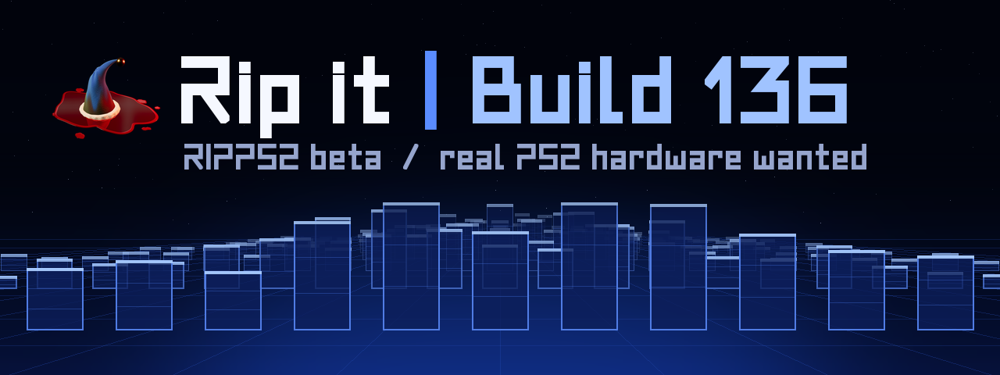
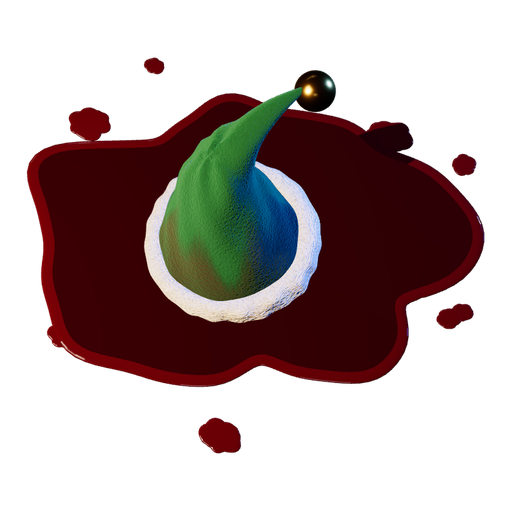

<!-- i18n: the language bar, made by ps2-pillars tools/readme-i18n -->
<p align="center">
  <a href="README.md">English</a> |
  <a href="README.es.md">Español</a> |
  <a href="README.pt-BR.md">Português (Brasil)</a> |
  <a href="README.pt.md">Português</a> |
  <a href="README.fr.md">Français</a> |
  <a href="README.de.md">Deutsch</a> |
  <a href="README.it.md">Italiano</a> |
  <a href="README.nl.md">Nederlands</a> |
  <b>Dansk</b> |
  <a href="README.sv.md">Svenska</a> |
  <a href="README.pl.md">Polski</a> |
  <a href="README.cs.md">Čeština</a> |
  <a href="README.hr.md">Hrvatski</a> |
  <a href="README.sr.md">Srpski</a> |
  <a href="README.bg.md">Български</a> |
  <a href="README.ru.md">Русский</a> |
  <a href="README.el.md">Ελληνικά</a> |
  <a href="README.hu.md">Magyar</a> |
  <a href="README.ro.md">Română</a> |
  <a href="README.gl.md">Galego</a> |
  <a href="README.sq.md">Shqip</a> |
  <a href="README.tr.md">Türkçe</a> |
  <a href="README.ar.md">العربية</a> |
  <a href="README.fa.md">فارسی</a> |
  <a href="README.ja.md">日本語</a> |
  <a href="README.ko.md">한국어</a> |
  <a href="README.zh-CN.md">简体中文</a> |
  <a href="README.zh-TW.md">繁體中文</a> |
  <a href="README.vi.md">Tiếng Việt</a> |
  <a href="README.lo.md">ລາວ</a> |
  <a href="README.id.md">Bahasa Indonesia</a> |
  <a href="README.fil.md">Filipino</a> |
  <a href="README.ceb.md">Cebuano</a>
</p>
<!-- /i18n -->

<p align="center"><sub>Oversættelse af den engelske README; hvis de afviger, gælder den engelske. <a href="README.md">English</a></sub></p>

<p align="center"><sub><b>RIPPS2</b> &nbsp;&middot;&nbsp; <a href="https://github.com/akilluminati47/RIPPS2/releases/latest/download/RIPPS2.elf">Hent</a> &nbsp;&middot;&nbsp; <a href="https://github.com/akilluminati47/BIBLE">BIBLE</a> &nbsp;&middot;&nbsp; <a href="https://github.com/akilluminati47/RIPPS2-themes">Temaer</a> &nbsp;&middot;&nbsp; <a href="https://github.com/akilluminati47/RIPPCSX2">RIPPCSX2</a> &nbsp;&middot;&nbsp; <a href="https://github.com/akilluminati47/RIPPS2-fonts">Skrifttyper</a> &nbsp;&middot;&nbsp; <a href="https://akilluminati47.github.io/RIPPS2/">Websted</a> &nbsp;&middot;&nbsp; <a href="https://www.psx-place.com/threads/ripps2-a-ps2-front-end-in-one-elf-launch-disc-storage-memory-files.51316/">psx-place</a> &nbsp;&middot;&nbsp; <a href="https://discord.gg/Z7m9u5kby">Discord</a></sub></p>

<p align="center"></p>

# RIPPS2

> ### Rip den: RIPPS2 build 136, v1.3.6 beta
> **RIP PS2, ELF-dræberen.** Selvforsynende, aldrig ødelæggende: dine andre ELF'er står trygt på [hylden](https://akilluminati47.github.io/RIPPS2/) (intet slettes, medmindre du beder om det), de får bare en velfortjent pause.
> 1. **[Hent RIPPS2.elf](https://github.com/akilluminati47/RIPPS2/releases/latest/download/RIPPS2.elf)** (altid den nyeste udgivelse) (én fil, 2.723 KB), og **[temapakken](https://github.com/akilluminati47/RIPPS2-themes/releases/latest)** hvis du vil (Adapt, Adapt Rx, udgave 136: en konfiguration og ét billede hver; RIPGRID og RIPFLOW er indbygget), og **[RIPPS2-languages.zip](https://github.com/akilluminati47/RIPPS2/releases/latest/download/RIPPS2-languages.zip)** til RIPPS2 på dit sprog (33 sprog; hver udgivelse har den med).
> 2. Kopiér den til en USB-nøgle eller et memory card, og start den fra FreeMcBoot, PS2BBL, wLaunchELF eller hvad du ellers bruger til at starte homebrew. I PCSX2: **System > Start File** og vælg `RIPPS2.elf`.
> 3. Fortæl os, hvordan det gik: [tråden på psx-place](https://www.psx-place.com/threads/ripps2-a-ps2-front-end-in-one-elf-launch-disc-storage-memory-files.51316/), [et issue](https://github.com/akilluminati47/RIPPS2/issues), eller **#RIPPS2** på udviklernes Discord, [discord.gg/Z7m9u5kby](https://discord.gg/Z7m9u5kby) (invitationen gælder til 1. december 2026).
>
> [Nyt i build 136](https://github.com/akilluminati47/RIPPS2/releases/tag/v1.3.6-beta) | [Changelog](CHANGELOG.md) | **[Videoer](#videos)** | [Alle udgivelser](https://github.com/akilluminati47/RIPPS2/releases) | [Snak om det på psx-place](https://www.psx-place.com/threads/ripps2-a-ps2-front-end-in-one-elf-launch-disc-storage-memory-files.51316/)<br>
> [Lav temaer til RIPPS2](https://github.com/akilluminati47/RIPPS2-themes) (uden genbygning, agentvenligt) | [Fyld dine AUDIO- og MEDIA-mapper](#the-sound-ripps2-was-made-with) med [RIPPS2 Media Studio](tools/media-studio) (lyde, musik og video; [hent det til Windows](https://github.com/akilluminati47/RIPPS2/releases/download/media-studio/RIPPS2-Media-Studio.zip)) | [Se et tema i ægte 720p og 1080i: RIPPCSX2](https://github.com/akilluminati47/RIPPCSX2/releases/latest) (PCSX2 med HDTV-udgang)

RIPPS2 er en PS2-frontend i én enkelt `.elf`: en nedrivning og genopbygning af [RiptOPL](https://github.com/NathanNeurotic/Open-PS2-Loader) (Open PS2 Loader-forken), med rickgaisers [Neutrino](https://github.com/rickgaiser/neutrino) som anden spilkerne, og med sit eget udseende, startere, filbrowser og gemmeværktøjer. Glastårne står bag dine spil og kredsløbsformationer bag dine filer, alt sammen tegnet live af PS2'en.

- **LAUNCH DISC** starter PS2-, PS1- og dvd-videodiske, siger hvilket spil der ligger i drevet, før du starter det, og afspiller lyd-cd'er med tårnene forvandlet til en spektrumanalysator. **RIPDISC** (build 105) ripper disken i drevet: et spil til dit lager, en cd eller dvd-video til dine filer.
- **STORAGE** er dit spilbibliotek: hvert drev i én liste (All Games viser dem alle fra første billede, også et drev der endnu ikke har svaret), med billeder, en infoside hvis billede glider over i skærmbillederne, indstillinger pr. spil og R3 til at give et spil en stjerne i Starred Games (stjernen sidder forrest i rækken; Settings > Game Sources > Starred Games Star flytter eller skjuler den; R3 holdt i 4,2 s skjuler eller viser alle stjerner). L2 + R2 springer til et tilfældigt spil, og Recent Games husker dine seneste starter. Trekant på et spil har **Hide Game**, **Delete** (hele spillet: hver del af imaget, dets CFG, billeder og snydekoder; dets gemte spil kun hvis du siger det), **Set Metadata (Rename)** og, for en ISO eller ZSO, **Compress to ZSO** eller **Uncompress to ISO** (eksperimentelt: ISO'en bliver, indtil ZSO'en er læst tilbage og kontrolleret). Hvert drevs spil vises med det samme fra dets seneste liste, og så læses drevet igen.
- **MEMORY FILES** er en indbygget filbrowser: kopiér, flyt og slet mellem memory cards, USB, MMCE og HDD'en (hver kopi læses tilbage og kontrolleres); åbn OPL's VMC-kortimages som mapper; eksportér og importér PSU-gemte spil; redigér tekstfiler; åbn billeder, afspil AVI-video **i fuld skærm** med **afspillerknapper** (Cross afspiller/pauser, Circle stopper, L1/R1 springer 10 s, L2/R2 lydstyrke, START gentager; tipsene fader ud under afspilning og bliver ved pause) ([RIPPS2 Media Studio](tools/media-studio) laver enhver video, også en telefons MP4, om til en), og afspil `.mp3`-, `.ogg`- og `.wav`-filer, eller markér flere og åbn dem sammen for at høre dem som én disk i Launch Discs cd-afspiller; en **`.tar` er en blå mappe**, du kan åbne, sætte billeder ind i og kopiere indhold ud af (build 125); Trekant på en `.tar` fletter en anden ART-`.tar` ind i den ([nedenfor](#covers-from-one-file-art-pack)). Den **åbne mappe er første række** og viser antal poster, antal markerede, samlet størrelse og drevets ledige plads; Cross eller Square på den markerer alt (eller, hvis noget er markeret, intet). START åbner dens indstillinger, hvor **SEARCH FILES** finder enhver fil eller mappe efter navn på hvert startet drev og åbner træet, hvor den ligger. Square på et memory card åbner **CARD MANAGER** (tag backup af et kort til en VMC, skriv en VMC's gemte spil tilbage på et kort, slet spillenes gemte spil, formatér), og Square på APA-HDD'en **HDD MANAGER** (dens partitioner, deres størrelser, og fjernelse af en efter en fuld kontrol af partitionstabellen).

Den er **beta** fra build 100: hundrede alpha-builds, testet på konsoller og i PCSX2 af ripto, nuno6573, zackcage6, eliminator1403, FifthFox og Mr.sus.60, og i betaen også af lukeatmynose og ahavasi, og af alle der tester på Discord, med særlig tak for al kærligheden på YouTube. Hav din sædvanlige loader ved hånden, og fortæl os hvad der går i stykker: feedback er det, der gør RIPPS2. **Den bedste måde at få RIPPS2 opdateret på er [et issue på GitHub](https://github.com/akilluminati47/RIPPS2/issues)**: DarkNerdShawny har åbnet tre, og FreeMcBoot-rettelsen i v1.1.7 kom fra et af dem. Vær som DarkNerdShawny.

<a id="videos"></a>

## Videoer

| Video | Længde | Hvad den viser |
| --- | --- | --- |
| [Rundturen](https://youtu.be/OEa8b5rbyco) | 10:48 | Alt hvad RIPPS2 kan i v1.2.8: websiden den begyndte som, dine spil på hvert tema, dine filer, lydene fra din egen konsol, menuen i spillet og hvad der er ombord, med kapitler i beskrivelsen |
| [v1.1.5-Shorten](https://akilluminati47.github.io/RIPPS2/media/b115/ripps2-v115-short.mp4) (på GitHub) | 0:39 | Cd-afspilleren til dine egne numre, Fast Boot, hvor rips havner, Set Metadata (Rename) |
| [v1.1.4-reelen](https://youtu.be/UwuKWfRtUEs) | 7:55 | Alt i v1.1.4, med kapitler i beskrivelsen |
| [v1.1.4-hjul-Shorten](https://youtube.com/shorts/iQqR9lsar9Q) ([eller på GitHub](https://akilluminati47.github.io/RIPPS2/media/b114/ripps2-v114-wheels-short.mp4)) | 1:10 | Hjulene du holder SELECT for |
| [Lydgennemgangen fra v1.1.2](https://akilluminati47.github.io/RIPPS2/media/b112/ripps2-v112-sounds.mp4) (på GitHub) | 2:11 | Hver lyd rippet fra konsollen, i én optagelse, fra opstartslyden til et spil der starter |
| [v1.1.0-reelen](https://youtu.be/Q8ZLd6ArV8s) | 3:57 | v1.1.0, klippet til Over the Rainbow |
| [Beta-reelen](https://youtu.be/LPjdK_E1jjM) | 9:45 | Den første beta, v1.0.0: websiden RIPPS2 begyndte som, så dine spil, dine filer og hvad der er ombord |
| [Build 99-Shorten](https://www.youtube.com/shorts/Ov5iA-tMcI8) | Short | Den sidste alpha |
| [Build 88-Shorten](https://www.youtube.com/shorts/Sqprz22tdtg) | Short | Build 88, sat til Slideshow |
| [Build 83-reelen](https://youtu.be/A27N9s6tumk) og [dens Short](https://youtube.com/shorts/4QBe5UO2KxM) | | Build 83, alpha |
| [Build 55-reelen](media/ripps2-b55-reel.mp4) og [build 22's demo](media/ripps2-b22-demo.mp4) (på GitHub) | | De tidlige alphaer |

<a id="highlights"></a>

## Højdepunkter

- **Temaer du kan gøre til dine egne.** Paneler af mat glas over hvert spils billede, et **Grid**-element til covers, hældning med højre stick der flytter en hel side som ét ark, og den første pakke, **[RIPPS2-themes](https://github.com/akilluminati47/RIPPS2-themes)**: Adapt og Adapt Rx, hver konfiguration indledes med en ordliste over alle nøgler, med en kontrol og en nøglereference til alle (og enhver agent), der vil lave flere. RIPGRID og RIPFLOW er indbygget, og temaer lavet til Open PS2 Loader virker som de er. Hold **SELECT** i 4,2 sekunder på en spilliste, og dine temaer åbner i et panel, du kan vælge fra (Settings > Interface > Hold SELECT: List, Cycle til næste tema, eller Off). På RIPGRID og RIPFLOW: hold højre stick til den ene side i 0,42 s, og det valgte cover vender om til bagsiden, og gitteret bladrer sine sider med en glidning.
- **Kategorierne hvor du vil have dem.** Settings > Interface > Layout > Category Layout: LAUNCH DISC, STORAGE og MEMORY FILES som navne **Across the Top**, som ikoner ned ad en **Sidebar** (Classic eller XL; Left på en liste eller Circle åbner den, og hver kategori har en skuffe med sine sider), eller **Menu**: ingen bjælke, kategorierne i START-menuen, som et tema til OPL har dem. På Theme bestemmer temaet: et tema til OPL får Menu, Adapt sidebjælken.
- **RIPFLOW**, den indbyggede cover-karrusel (og RIPGRID, også indbygget), og en startdisk når et spil starter (Layout > Launch Disc): **Pop In**, **Spin** eller **Zoom**, der gør disken større, til den er tydelig at læse, og holder den der (RIPFLOWs og Adapts standard), eller Off. **Hints and Glyphs** (Interface): dit eget layout og rækkefølge for tips, mærker og fire glyfsæt (temaets, RIPPS2's, Standard og White). **Colors and Text** (Interface): ti Color Themes (RIPPS2, Ember, Blood, Ectoplasm, Amethyst, Bone, Tangerine, Flamingo, Turquoise, Moonlight) eller Custom, et **Color Sweep** der glider gennem fem farver (Rainbow, én lavet af hvert Color Theme, eller op til fire af dine egne), og Text Weight. Layout har tips og kategoribjælke der fader, og kildens navn der dukker stort op midt på siden. Temaer kan vælge det hele selv, og dine egne indstillinger vinder altid.
- **Det den skal bruge, ombord; det du har, fundet.** BIBLE kører med i den ene `.elf` og installerer sig, hvor du vælger; din egen [Neutrino](https://github.com/rickgaiser/neutrino), POPSTARTER, dine POPS-filer og Ember søges på dine drev én gang, huskes og startes derfra, hvor de ligger. **STATUS** i START-menuen viser hvert drev, hvor hver starter blev fundet (LOOK FOR THEM søger igen), homebrewet, BIBLE og dine lyde, og **SAVE DIAGNOSTICS** skriver `DIAG.TXT` til en fejlrapport.
- **En hurtig opstart.** Settings > Game Sources > Cache > **Fast Boot** læser kun RIPPS2's eget drev ved opstart: indstillingerne og lydene ved siden af `RIPPS2.ELF`, og hver liste fra dens cache. De andre drev venter, til du trykker SELECT på deres side eller vælger et af deres spil. Et spil valgt, mens RIPPS2 stadig læser eller skriver, venter bag et panel, der siger hvad der mangler (START NOW går med det samme), så en start afbryder aldrig en skrivning.
- **Dine indstillinger hvor du vil have dem**: Settings > General & System > Save Settings To gemmer dem i RIPPS2's gemte data på et memory card, i en RIPPS2-mappe på den interne HDD (exFAT, eller APA-HDD'ens OPL-partition), et USB-drev, MX4SIO, iLink eller MMCE (læses først ved opstart), eller i en mappe du skriver.
- **Billedet hvor dit tv vil have det.** Settings > Interface > Screen: Video Mode (op til 720p og 1080i), Widescreen, og H-POS, V-POS og Overscan, som fra build 124 gemmes for hver videotilstand, så 1080i og 480i hver beholder deres egen centrering.
- **BIBLE og BOOT LOCK.** Settings > General & System > Boot Loader viser, hvad hvert memory card starter, når der tændes, og installerer **BIBLE**, PS2BBL sat op til RIPPS2, på et memory card. **Boot Lock** indstiller den bootloader, din konsol faktisk starter, så den starter RIPPS2: PS2BBL og FreeMcBoot starter den med det samme, OSDMenu sætter den øverst i sin menu, og at slå det fra sætter det tilbage, der var før.
- **En menu i spillet** (Settings > Game Launching > In-Game Menu, slået til som standard): L1+L2+R1+R2+SELECT+START sætter et spil på pause, lydløst, over dets eget billede, under Resume, Exit Game, **Screenshot** (RIPSHOT, [nedenfor](#screenshots-in-game-ripshot)), Achievements og Power Off (et tryk mere slukker PS2'en på stedet); RESUME giver præcis det billede tilbage, og Achievements viser, hvad du har tilbage at jage, og hvordan du opnår det. **Exit Game går gennem konsollens egen opstartsvej:** med IGR Path på den side tom (standard) går genstarten til browseren, som starter din bootloader (FreeMcBoot, PS2BBL, OSDMenu eller BIBLE), når der er en installeret, og RIPPS2 igen med Boot Lock slået til, sådan som konsollen starter, når den tændes; uden nogen PS2-browseren. Fra v1.2.1 er det aldrig en sort skærm: en IGR Path bruges kun, når genstarten kan indlæse den (en ELF på et memory card eller et FAT32-USB-drev), og den ikke er RIPPS2 selv, og STATUS siger, når en springes over.
- **Achievements** (SpiritofRA): RetroAchievements-telemetri gennem [xeRAbora](https://github.com/hacan359/xerabora)-klienten på din pc (låst til [v0.1.0-alpha.18](https://github.com/hacan359/xerabora/releases/tag/v0.1.0-alpha.18)), mærker på fulgte spil, disken i skuffen, og **YOUR ACCOUNT**, hvert spil du har tjekket med det du har låst op, og, med xeRAbora åben for netværket, **LEFT TO HUNT**: hver låst præstation og hvordan du opnår den.
- **Cover Art** (Settings > Network) hentet af PS2'en selv til hvert PS2-spil, der ikke har noget, fra xlenores ps2-covers på GitHub (det kræver netværkskablet og internettet): vælg **HD** (280 × 400, skarpere på en HD-skærm) eller **Standard** (140 × 200, som Open PS2 Loaders), begge 8-bit med dithering; et spil der allerede har et cover, beholder det (build 125). **720p og 1080i** tegnet i ét gennemløb: et billede på 640 pixels i bredden med hver linje i tilstanden, strakt ud over skærmen af konsollens eget billedkredsløb, så hver animation beholder sin fart. **RIPFLOW viser fem covers på et 16:9-billede** (720p, 1080i eller Widescreen slået til) og tre på 4:3 og bliver selv bredere, medmindre du vælger et antal (build 125). Din **AUDIO**-mappe findes på ethvert drev, og tårne og kugler kører hele natten med stabile 60 fps.
- **Rækværk**: hver build kører RiptOPLs værtstjek og RIPPS2's egne, og en ny advarsel i en RIPPS2-fil får den til at fejle.

<a id="in-your-language"></a>

## På dit sprog

Fra build 104 oversættes hvert ord, RIPPS2 viser, dens egne sider og tips såvel som Open PS2 Loaders indstillinger. Hver build kommer med **`RIPPS2-languages.zip`**: kopiér dens `LNG`-mappe til roden af et USB-drev, HDD'ens OPL-partition eller et MMCE-kort (eller filerne i den til `mc0:/RIPPS2`), og vælg så sproget i **Settings > Interface > Language**. 33 sprog læser hele RIPPS2, fra fransk, spansk, tysk og portugisisk til russisk, græsk, tyrkisk, vietnamesisk, laotisk, kinesisk, japansk og koreansk, og arabisk og persisk fra højre mod venstre med sammenhængende bogstaver; et sprog der har brug for andre bogstaver, har sin skrifttype i pakken ved siden af. Rettelser og nye sprog lægges i [`elf/lang`](elf/lang) (én `<Language>.yml` hver; `python3 elf/lang/ripps2lang.py check` tjekker dem).

<p align="center">


</p>

<a id="rip-a-disc"></a>

## Rip en disk

Læg disken i drevet og åbn **LAUNCH DISC**. Efter et par sekunder tilbyder et glaspanel **RIPDISC**: hold **SELECT**, til ringen er fyldt. Næste trin siger, hvad disken er, dens størrelse, **hvor lang tid det burde tage**, og hvor den skal hen; bekræft, og så **START**.

- **Et PS2-spil** bliver til en ISO i et drevs DVD- eller CD-mappe, i din spilliste. Et spil over 4 GB, der skal på et FAT32-drev, gemmes i stedet som Open PS2 Loaders dele på 1 GB med ul.cfg; på et exFAT-drev (en USB-nøgle, MX4SIO, iLink eller den interne HDD) forbliver det én ISO. Pladsen på drevet tjekkes, før rippet begynder.
- **Et PS1-spil** bliver til en BIN og CUE i `EMBER/games/<Title>/`, spillet med Ember.
- **En lyd-cd eller en dvd-video** går til dine filer: Memory Files åbner på **MEDIA** (ved siden af AUDIO) med disken på udklipsholderen som **RIPPED**; PASTE i en hvilken som helst mappe ripper den dertil. En cd lander som WAV'er (kopiér en ind i AUDIO, og den er i din menumusik), en dvd du selv har lavet som dens VIDEO_TS-filer. Købte film er kopibeskyttede, og drevet vil ikke læse dem.

PS2'ens USB er langsom (USB 1.1, omkring 1 MB i sekundet): en hel dvd til en nøgle tager over en time, til den interne exFAT-HDD en brøkdel af det. Estimatet lærer din konsols egen fart fra dit første rip.

<p align="center">


</p>

<a id="screenshots-in-game-ripshot"></a>

## Skærmbilleder i spillet (RIPSHOT)

I et spil: L1+L2+R1+R2+SELECT+START, så **SCREENSHOT**: det billede der var på skærmen, da menuen åbnede, uden menuen i. Vælg **ART** (spillets skærmbilledgrafik, 250 x 188, `_SCR`, `_SCR2`...), **MEDIA** (fuld størrelse, i en mappe opkaldt efter spillet) eller **BOTH**; hver viser den fil, det bliver til, dens størrelse og de billeder, der er tilbage. **SAVE** fader menuen væk, **KEEP** eller **DELETE** bestemmer.

Billederne venter på spillets filmrulle i `MEDIA/RIPSHOT` (6 pr. spil), til de fremkaldes til 8-bit-PNG'er: i hånden fra Memory Files (åbn `MEDIA/RIPSHOT`: VIEW et billede, ACTIONS for at fremkalde det), eller af sig selv i baggrunden med **Develop Shots: Auto** (Settings > Game Launching > In-Game Menu). Temaer viser hvert billede, et spil har, med nøglen `SCRn`: RIPPS2's infoside-diasshow, RIPGRID, RIPFLOW og Adapt gør det. RIPSHOT virker for spil på USB, den interne exFAT-HDD, MX4SIO, iLink og, fra build 117, MMCE (en SD2PSX's SD gemmer rullerne); spil på APA-HDD'en kommer i en senere build.

<p align="center">


</p>
<p align="center">


</p>

<a id="your-own-sounds-and-music"></a>

## Dine egne lyde og din egen musik

Læg en `AUDIO`-mappe ved siden af `RIPPS2.elf`. Den tager lydeffekter som `.adp`-filer opkaldt efter deres hændelser (RiptOPLs `boot`, `cancel`, `confirm`, `cursor`, `message`, `transition`, `bd_connect`, `bd_disconnect`, og RIPPS2's `page_in`, `page_out`, `error`, `save`, `launch`, `disc`, `random`), og musik som enhver `.ogg` (Ogg Vorbis uden tags), 16-bit `.wav` eller (fra build 115) `.mp3`: `bgm_01 Title.ogg`, `bgm_02 Title.ogg` sætter rækkefølgen og titlen, og siden build 105 vises ethvert andet navn, som det er, så et nummer rippet fra en cd skal ikke omdøbes. Settings > Audio > Music vælger nummeret. RIPPS2 skriver en `README.txt` ind i AUDIO (og MEDIA), der siger alt dette. **[RIPPS2 Media Studio](tools/media-studio)** klarer det hele på din pc (og laver dine videoer om til den AVI, Memory Files afspiller): gå til en hvilken som helst lyd eller sang, hør den som den er og som PS2'en vil spille den, konvertér den (eller en hel mappe) til `output/AUDIO`, og kopiér den mappe ved siden af `RIPPS2.elf` med en USB-nøgle og RIPPS2's Memory Files. Peg den på BIOS-dumpet fra din egen PS2, og den laver konsollens egne menulyde og systemmusik ud fra det, klar til brug. (`elf/theme/tools/make_adp.py` og `make_sound_pack.py` gør stadig det samme fra kommandolinjen.) RIPPS2 kommer slet ikke med lyde eller musik: siden build 95 har den intet indbygget, så uden en `AUDIO`-mappe er den tavs, og **STATUS > SOUNDS** siger, hvad den fandt.

**Hvor AUDIO og MEDIA skal ligge.** Hold `AUDIO` ved siden af `RIPPS2.elf`, på det drev RIPPS2 starter fra: opstarten læser den først, og med **Fast Boot** slået til (Settings > Game Sources > Cache) læses opstartslyden med indstillingerne, før drevene og listerne starter, så den allerede spiller, når tårnenes første billede kommer frem (fra build 118). RIPPS2 på et memory card med `AUDIO` på et drev: efter **BIOS Sounds > Rip** kopierer START kun `boot.adp` (omkring 360 KB) ved siden af RIPPS2 på kortet, så opstartslyden spiller, mens søjlerne rejser sig, i stedet for når drevet er klar (fra build 121). Hold kun det, menuerne spiller, der. `MEDIA` (rippede cd'er og dvd-videoer, billeder i fuld størrelse) er til dit største drev: intet i den læses ved opstart, så hvor hurtigt det drev læser, betyder ikke meget.

<a id="the-sound-ripps2-was-made-with"></a>

### Lyden RIPPS2 blev lavet med

RIPPS2 lyder som en PS2, der aldrig forlod stuen: **Sonys egne konsollyde**, Sony-systemmusik og **ét Nintendo-nummer** at browse til (RIPPS2-designerens egne valg). Intet af det følger med RIPPS2; **[RIPPS2 Media Studio](tools/media-studio)** får dig derhen fra [BIOS-dumpet fra din egen PS2](https://pcsx2.net/docs/setup/bios/) (den fil PCSX2 bruger) og dine egne kopier af musikken. Dens **Start** ripper konsollens lyde ind i en fuld `AUDIO`-mappe; dette er kortet, de går ind i. Eller spring pc'en over: **Settings > Audio > BIOS Sounds > Rip** skriver konsollens egne lyde direkte ind i `AUDIO`: menulydene og (siden build 89) opstarts- og spilstartmusikken spillet ud fra BIOS'ens egne noder. BIOS Music ved siden af ripper menumusikken, urets stykke (eller den røde skærms, eller begge: build 112). **[Lydgennemgangen fra v1.1.2](https://akilluminati47.github.io/RIPPS2/media/b112/ripps2-v112-sounds.mp4)** spiller hver eneste i én optagelse, fra opstartslyden til et spil der starter.

| | Øjeblik | `AUDIO`-fil | Sonys lyd, fra din egen PS2 (Media Studio > Your BIOS) |
|:-:|---|---|---|
| ▶ | Opstart, mens tårnene rejser sig | `boot.adp` | **boot** ("Bootup") |
| ◆ | Ind på en infoside eller i Settings | `page_in.adp` | **Menu sound 3** |
| ◇ | Tilbage til listen | `page_out.adp` | **Menu sound 2** |
| ↕ | Markør | `cursor.adp` | **Menu sound 7** |
| ✕ | Bekræft | `confirm.adp` | **Menu sound 5** |
| ○ | Annullér | `cancel.adp` | **Menu sound 13** |
| ⇄ | Launch Disc, Storage, Memory Files | `transition.adp` | **Menu sound 10** |
| ✉ | En besked, en disklæsning | `message.adp`, `disc.adp` | **Menu sound 11** |
| ✓ | Gem | `save.adp` | **Menu sound 12** |
| ! | Fejl | `error.adp` | **Menu sound 4** |
| ★ | Spilstart | `launch.adp` | **PS2-logoet** ("Game Boot") |
| ◀ | Drev sat i | `bd_connect.adp` | **Menu sound 8** |
| ▷ | Drev fjernet | `bd_disconnect.adp` | **Menu sound 9** |
| ⚄ | Tilfældigt spil (L2 + R2) | `random.adp` | **Menu sound 6** |

<sub>Menulydene er nummereret, som Media Studio viser et dump fra en SCPH-39001. Start lægger allerede de fleste på plads; til dette kort skal du konvertere save, error, random og de to drevlyde fra de menulyde, der er nævnt her.</sub>

| Musik | Nummer | Fra | Sådan får du det |
|---|---|---|---|
| `bgm_00 Menu.wav` | **Menu** (uret, 5:04) | PS2-systemmusik (Sony): browserens hovedmenu, det stykke uret spiller | Rip det i RIPPS2: **Audio Settings > BIOS Music > THE MENU MUSIC** (fra din egen konsols BIOS). Det spiller, når intet andet nummer er valgt |
| `bgm_01 Red Screen.wav` | **Red Screen** (diskadvarslen, 5:31) | PS2-systemmusik (Sony): den røde "indsæt en disk"-skærms stykke | Rip det i RIPPS2: **Audio Settings > BIOS Music > THE RED SCREEN MUSIC** (BOTH i samme liste ripper menuens og den røde skærms efter hinanden, hver i sin egen fil) |
| `bgm_01 Slideshow.ogg` | **Slideshow (Daytime)** | Wii'ens [News Channel](https://en.wikipedia.org/wiki/News_Channel_(Wii)), af [Kazumi Totaka](https://en.wikipedia.org/wiki/Kazumi_Totaka) (Nintendo, 2006): det forslag RIPPS2 blev sat i tempo efter, og **baggrundsmusikken i RIPPS2's videoer på YouTube** (beta-reelen, build 83-reelen og Shorten, build 88-Shorten) | din egen kopi, konverteret på din pc med [RIPPS2 Media Studio](tools/media-studio) |
| `bgm_02 Details.ogg` | **Details** | x-Radar Portable, [PSP-systemmusik](https://en.wikipedia.org/wiki/PlayStation_Portable_system_software) (Sony, 2010): **baggrundsmusikken i RIPPS2's videoer på YouTube** sammen med Slideshow (beta-reelen åbner med den, og build 83-reelen og Shorten) | din egen kopi, konverteret på din pc med [RIPPS2 Media Studio](tools/media-studio) |

<a id="covers-from-one-file-art-pack"></a>

## Covers fra én fil (ART Pack)

Fra build 118 pakker **Settings > Game Sources > Cache > ART Pack** `ART`-mappen fra hvert startet drev i én `art.tar` i `ART`-mappen på det drev, du vælger. RIPPS2 måler, hvor hurtigt hvert drev læser sine egne billeder, og viser det hurtigste først, så X tager det (en SD2PSX's SD, for eksempel). Billederne kommer ind, som de er (PNG og JPG er allerede komprimeret: tar'en samler dem bare, og en pc åbner den som enhver tar), og `ART`-mapperne røres ikke. Fra da af indlæses covers fra den ene fil gennem ét indeks (skrevet med pakken, så første opstart ikke skal scanne den), og `ART`-mappen for et spil, pakken blev bygget til, bliver aldrig spurgt ét billede ad gangen, manglende billeder medregnet: mindre læsning på det drev, musikken streamer fra, og billeder der følger med markøren. Billeder RIPPS2 henter eller tager senere, vises med det samme; billeder du kopierer ind på en pc, vises, når du bygger pakken igen. Du kan kopiere `art.tar` ind i et andet drevs `ART`-mappe med Memory Files, men byg den på det drev, du browser fra. Samme knap fjerner pakken.

**Flet én `.tar` ind i en anden** (build 123). Pak et stort drev én gang som master, og pak senere kun de nye spils billeder og flet den lille `.tar` ind i den, i stedet for at pakke hver ART-mappe igen. I Memory Files: Trekant på en `.tar` > **MERGE A .TAR INTO THIS**: den `.tar` er den, der beholdes, og RIPPS2 viser de andre at flette ind (i den mappe, i hvert startet drevs ART-mappe og i dets rod). Cache > ART Pack tilbyder det samme for pakken i brug, og lige efter en pakke er bygget. Et billede, der er i begge, kommer fra den indflettede `.tar`, og de to spillister bliver til én. Fletningen skrives ved siden af den beholdte `.tar` og overtager først dens navn, når hver byte er på drevet, så et stop, et fuldt drev eller et udtaget kort efterlader den beholdte, som den var. Til sidst nævner en boks begge filer og spørger, om den indflettede skal slettes (START sletter den, Back beholder den); den beholdte bliver aldrig tilbudt.

<a id="your-hardware"></a>

## Din hardware

- **Netværksadaptere og den interne HDD.** RIPPS2 styrer hver netværksadapter med PS2SDK's egen DEV9-driver, den som nuværende loadere bruger, og kender selv de to slags fra hinanden: udvidelsesbåsens adaptere til fat-konsollerne (SCPH-10281, SCPH-10350 og de IDE- og SATA-adaptere, der er lavet ud fra dem) og slim-modellens indbyggede port, og PC CARD-adapteren til de første japanske konsoller (SCPH-10000 til 18000). Der er ingen gammel driver at vælge. HDD'en læses på samme måde, uanset om den er APA eller exFAT, og en HDPro-adapter får sin egen driver. SMB-spil, UDPBD og hentning af billeder bruger alle den samme adapter. Hvis din ikke dukker op, så skriv adapterens og konsollens model.
- **VMC'er (virtuelle memory cards).** Et spils egne indstillinger (dets VMC-rækker) giver det et kortimage i `VMC`-mappen på spillets drev, i slot 1 eller 2. Med OPL-kernen virker de på USB, MX4SIO, iLink, exFAT-HDD'en, APA-HDD'en, SMB og MMCE; på et FAT32- eller exFAT-drev skal kortet være én sammenhængende fil, hvilket RIPPS2 laver nye som, og **Rebuild** retter et ældre, der ikke er det. Med Neutrino virker de på USB, MX4SIO, iLink og exFAT-HDD'en, men ikke på APA-HDD'en, hvor spillet bruger det rigtige kort i det slot. En SD2PSX kan også selv give hvert spil sit eget kort (GameID i dens indstillinger), helt uden VMC.
- **Neutrino.** RIPPS2 bruger din egen Neutrino, uanset version (fra build 135 har det ingen med, og et spil, der ikke finder nogen, siger, hvor den skal ligge): læg dens `neutrino`-mappe på spillets drev eller et memory card, eller angiv dens sti i Settings > Game Launching > Neutrino Defaults, og RIPPS2 sender den kun de indstillinger, den version kender. Fra 1.1.5 får den det rigtige drevnummer, når RIPPS2 startede fra et USB-drev, og spillet er på den interne exFAT-HDD (den blanding fik Neutrino til at stoppe og konsollen til at genstarte).
- **USB-controllere RIPPS2 ikke kendte** (build 129). **Settings > Controllers > Set Up A USB Pad**: sæt controlleren i, tryk på hver knap RIPPS2 beder om, og den skriver controllerens `.pad`-profil (`PADS/VVVV_PPPP.pad` ved siden af RIPPS2, ren tekst: [formatet](docs/plans/pad-spec.md)). En controller med profil styrer menuen og spiller, med Pad Emulator slået til, i spil; `PADS/GAMES/<game ID>.pad` flytter knapper for ét spil. **My Pads** tjekker hver profil og siger, hvad der er galt med dem, den afviser.
- **Apps som SMS.** En app starter fra sin egen sti. SMS (Simple Media System) læser kun den, så RIPPS2 kan ikke give den en fil at afspille; hvis en version af SMS tager imod en, sender RIPPS2 den videre.

<a id="how-it-is-built"></a>

## Sådan bygges den

`elf/build.sh` tager RiptOPL ved det commit, der står i `elf/RIPTOPL_REF`, anvender patchserien i `elf/patches`, tilføjer RIPPS2-temaet, skrifttyperne og billederne fra `elf/theme` og bygger `RIPPS2.elf`. GitHub Actions kører det ved hvert push ("Build RIPPS2.elf"); ELF'en er kørslens artefakt.

<a id="the-web-version"></a>

## Webversionen

RIPPS2 startede som et webtema, og den version er her stadig: **live demo** på https://akilluminati47.github.io/RIPPS2/

| Valg | Åbner |
| --- | --- |
| **Launch Disc** | Søjlerne, med en dobbelt eksplosion affyret midt i feltet |
| **Storage** | Alfehylden, foran søjlerne |
| **Memory Files** | Kuglerne |

PS2-mærket kører under det valgte punkt og flyver mellem dem: et sving til naboen, et dybere dyk med plat eller krone, når det går fra den ene ende til den anden. Etiketterne følger besøgendes systemsprog (18 sprog, kan tilsidesættes med `?lang=fr` og lignende). Det, menuskrifttypen ikke kan tegne, falder tilbage til en ren sans som et helt ord.

**Alfehylde:** Storages udstillingsvindue. uOPLs træplanke foran tårnene, og på den RIPPS2-mærket ti gange: en død alfs filthat stående med skyggen nedad i sin egen blodpøl, én for hvert Color Theme (RIPPS2, Ember, Blood, Ectoplasm, Amethyst, Bone, Tangerine, Flamingo, Turquoise, Moonlight). Tre vises ad gangen, sådan som RIPFLOW viser covers: den midterste drejer sig for at se på markøren (jo tættere, jo hurtigere drejer den) og vipper på sin fjeder, og Left / Right eller et tryk på en af naboerne drejer hylden. Den lander på den blå RIPPS2-hat. En hat, der trykkes, sender sit Color Theme hen over tårnene (ELF'ens egen farvematrix, så tårnene ser ud, som det tema gør dem): et tryk er et farvestød, der krydser feltet og skyller tilbage til RIPPS2's blå; holdt nede bliver temaet over hele renderingen, til man slipper.

**Telefoner holdt lodret** (`letterbox.js`): siden kører i en letterbox-afspiller øverst på skærmen med kun kameraets og de buede hjørners indryk over sig, sat op som på en liggende skærm og skaleret til at passe. Under den en pil op til afspilleren, en lysende note om at knibe for at zoome eller vende telefonen, og en kontakt mellem en 16:9- og en 4:3-boks (huskes); en fodnote i nederste højre hjørne lyder RIPPS2 (vision interactive mock-up). At vende telefonen går tilbage til hele siden, på den side afspilleren viste. `?letterbox=1` viser afspilleren på en computer.

**Søjler:** glasdatatårne med glødende kanter, sømme, flimrende celler og energipulser på et spejlende gulv. Tårnene rejser sig op af jorden ved indlæsning og ånder og bølger så; markøren sender krusninger, og et klik udløser en eksplosion. Tilpasser opløsningen på langsomme enheder, pauser uden for skærmen og respekterer reduceret bevægelse.

**Kugler:** tolv formationer (Browser Orbit, Borromean Rings, Torus Orbit, Icosahedron, Double Helix, Strange Attractor, Trefoil Knot, Mobius Strip, Klein Bottle, Golden Spiral, Lissajous og Seven-Point Star), hver med så mange kugler som den behøver, der deler sig og smelter sammen mellem dem. Som i ELF'ens Memory Files tegner hver forms omrids sig med et glimt, når fanen åbnes, og hver gang en formation falder på plads, holder i omkring to sekunder og fader ud. Tryk og hold på scenen (eller hold `L`, eller en controllers L2 eller Cross) for hele banen, stille; træk mens du holder for at dreje formationen, som glider til standsning, når du slipper (en controllers højre stick drejer den også). Skift med et swipe, Left / Right-glyferne ved siden af navnet, piletasterne, eller en controllers d-pad eller skulderknapper.

For at køre den lokalt, servér mappen (ES-moduler kræver en webserver) og åbn http://localhost:8000:

```bash
python -m http.server 8000
```

Tilføj `?t=12` for at springe søjleintroen over, eller `?f=3#memory-files` for at åbne en bestemt formation (gamle `orbs.html`-links ender på Memory Files).

<a id="credits"></a>

## Krediteringer

RIPPS2 er designet og instrueret af akilluminati47 og bygget med Claude (Anthropic). Testere: ripto, nuno6573, zackcage6, eliminator1403, FifthFox, Mr.sus.60, lukeatmynose, ahavasi og alle der tester på Discord. Issues på GitHub: DarkNerdShawny og alle der åbner et (et issue er den bedste måde at få RIPPS2 opdateret på: vær som dem og [åbn et](https://github.com/akilluminati47/RIPPS2/issues)). Særlig tak også for al kærligheden på YouTube: jeg hjælper gerne, uanset hvordan du når mig.

- [RiptOPL](https://github.com/NathanNeurotic/Open-PS2-Loader) af NathanNeurotic og [Open PS2 Loader](https://github.com/ps2homebrew/Open-PS2-Loader)-holdet (AFL-3.0), som RIPPS2 er bygget på. Deres fulde krediteringer står på RIPPS2's About-side.
- [Neutrino](https://github.com/rickgaiser/neutrino) af [rickgaiser](https://github.com/rickgaiser) (AFL-3.0), den lille, hurtige og modulære enhedsemulator, der er RIPPS2's anden spilkerne: RIPPS2 finder og bruger din, i enhver version; RIPPS2.elf havde dens build med til og med build 134 ([`elf/neutrino`](elf/neutrino/README.md)). Vælg den som Default Loader Core i Settings > Game Launching.
- [xeRAbora](https://github.com/hacan359/xerabora) af [hacan359](https://github.com/hacan359): RetroAchievements-pc-klienten og RetroAchievements-koden på konsolsiden, som RIPPS2 arver gennem RiptOPL (MIT / AFL-3.0). **LEFT TO HUNT** læser grænsefladesidens `GET /state` på port 18280, som ikke er en del af den dokumenterede konsolprotokol og kan ændre sig mellem alphaer, så RIPPS2 er låst til **[v0.1.0-alpha.18](https://github.com/hacan359/xerabora/releases/tag/v0.1.0-alpha.18)**, den udgivelse forfatteren anbefaler (alpha.10 er ustabil, og nøglen `checked_only`, som LEFT TO HUNT læser, findes kun i `/state` fra alpha.11); tjekket mod den udgivelses `/state`-kode, andre versioner er ikke testet.
- [ESR](https://gitlab.com/ffgriever/esr/) af ffgriever: Launch Disc starter din egen kopi til ESR-diske.
- [Ember](https://github.com/Gageformer/Ember/releases) af Gageformer, PS1-emulatoren til PS2: RIPPS2 starter din egen `ember.elf` fra `EMBER`-mappen på det drev, dine spil ligger på (build 71 til 112 havde dens Beta-2-build med; [`elf/ember`](elf/ember/README.md)). Tag din egen PS1-BIOS med.
- [POPSTARTER](https://www.psx-place.com/resources/popstarter.683/) af krHACKen starter PS1-spil fra din egen kopi, som RIPPS2 finder på dine drev og memory cards ([`elf/popstarter`](elf/popstarter/README.md)).
- [PS2BBL](https://github.com/israpps/PlayStation2-Basic-BootLoader) af El Isra (israpps) og [PS2BBL Extended](https://github.com/saildot4k/PlayStation2-Basic-BootLoader-Extended) af saildot4k: BOOT LOCK redigerer deres konfiguration, så konsollen starter RIPPS2 (fra build 116 også FreeMcBoots og OSDMenus). Fra build 134 har RIPPS2.elf [BIBLE](https://github.com/akilluminati47/BIBLE) med, vores PS2BBL-variant signeret til RIPPS2, som **Boot Loader > Manage** installerer (build 69 til 133 havde El Isras PS2BBL 1.2.0 med). Licensen (GPL-3.0) og kildekoden ligger i [`elf/bible`](elf/bible/README.md); bindingen til kortet bruger ps2sdk's åbne SECRMAN (AFL), uden nøgler.
- **MMCE-kort**: [sd2psXtd](https://sd2psxtd.github.io/)-firmware på en SD2PSX, som [SD2PSXTD](https://github.com/LinkRetro/SD2PSXTD-Hardware)-kortet, læst gennem [mmceman](https://github.com/ps2-mmce/mmceman) (ps2-mmce): spil, VMC'er og indstillinger på kortets SD. **Hold firmwaren opdateret** ([sd2psxtd.github.io/download](https://sd2psxtd.github.io/download)). At komprimere et spil på kortet kræver sd2psXtd 1.4.0 eller nyere (den omdøber det færdige image på plads); RIPPS2 spørger kortet først, så med ældre firmware får du det at vide, før noget begynder, og der kan ikke komprimeres dér. Kortet kan ikke oplyse sin ledige plads, så selv på 1.4.0 er der intet pladstjek før komprimering: lad der være plads til spillet og dets ZSO side om side (bliver kortet fuldt, stopper arbejdet og fjerner det, det skrev).
- [wLaunchELF](https://github.com/ps2homebrew/wLaunchELF) af ps2homebrew-holdet, og wLaunchELF R3Z af NathanNeurotic: forbillederne for Memory Files-browserens opførsel og dens indstillingsgitter.
- [Apollo Save Tool](https://github.com/bucanero/apollo-ps2) af bucanero: forbilledet for gemmeværktøjerne (PSU, kortimages). RIPPS2's egen kode, skrevet ud fra formaterne.
- [ps2sdk](https://github.com/ps2dev/ps2sdk) af ps2dev-holdet: memory cardets filsystem (mcman) og USB-tastaturdriveren.
- mymc af Ross Ridge og [mymcplus](https://github.com/thestr4ng3r/mymcplus) af Florian Maerkl: det RIPPS2's skrivninger af kortimages tjekkes imod.
- [minimp3](https://github.com/lieff/minimp3) af lieff (CC0 1.0, public domain): MP3-afspilning i Memory Files og AUDIO, fra build 115, uændret i RiptOPLs `thirdparty/minimp3`.
- Planet N Compact af [Iconian Fonts](https://www.iconian.com) (`assets/master.ttf`), og Planet N Condensed (`elf/theme/fonts/ripps2_condensed.ttf`, indbygget fra build 115 som `builtin:ripps2condensed`, Adapts listeskrift). [RIPPS2 Sleek](https://github.com/akilluminati47/RIPPS2-fonts) (Regular, Bold, Bold Case) er tegnet til RIPPS2; dens eget repo har skrifttyperne som TTF og WOFF2 under OFL.
- Webversion: [three.js](https://threejs.org) r160, MIT (se `vendor/LICENSE`); [Albert Sans](https://github.com/usted/Albert-Sans), SIL Open Font License (se `vendor/fonts/OFL.txt`).
- Web-mockuppens alfehylde (Storage, [akilluminati47.github.io/RIPPS2](https://akilluminati47.github.io/RIPPS2/)) står på træplanken fra [uOPL](https://github.com/SlimPugGamer/uOPL) (`gfx/plank.png`, AFL-3.0).
- RIPPS2-mærket, den døde alf i sin blå hat, er originalt: renderet i three.js (MIT) fra `media/deadelf/scene.html` (hver vinkel og farve i `media/deadelf`), med en vektorversion i `assets/ripps2-deadelf.svg`.
- Build 83-reelen og Shorten (på YouTube) er sat til Details (x-Radar Portable, PSP-systemmusik, Sony), Slideshow (Daytime) af Kazumi Totaka fra Wii'ens News Channel (Nintendo, 2006) og PS2'ens eget Menu-tema (Sony); build 66-reelen til Slideshow (Daytime); musikken i build 55-reelen er original. Spilbilleder set under test kom fra fællesskabets OPL-billeddatabase og er ikke en del af RIPPS2.

Uofficielt fanprojekt. PlayStation, PS1, PS2, PlayStation-logoet og PS2-logoet er varemærker tilhørende Sony Interactive Entertainment. Dette projekt er hverken tilknyttet eller godkendt af Sony.

<p align="center"></p>

<p align="center"><sub><b>RIPPS2</b> &nbsp;&middot;&nbsp; <a href="https://github.com/akilluminati47/RIPPS2/releases/latest/download/RIPPS2.elf">Hent</a> &nbsp;&middot;&nbsp; <a href="https://github.com/akilluminati47/BIBLE">BIBLE</a> &nbsp;&middot;&nbsp; <a href="https://github.com/akilluminati47/RIPPS2-themes">Temaer</a> &nbsp;&middot;&nbsp; <a href="https://github.com/akilluminati47/RIPPCSX2">RIPPCSX2</a> &nbsp;&middot;&nbsp; <a href="https://github.com/akilluminati47/RIPPS2-fonts">Skrifttyper</a> &nbsp;&middot;&nbsp; <a href="https://akilluminati47.github.io/RIPPS2/">Websted</a> &nbsp;&middot;&nbsp; <a href="https://www.psx-place.com/threads/ripps2-a-ps2-front-end-in-one-elf-launch-disc-storage-memory-files.51316/">psx-place</a> &nbsp;&middot;&nbsp; <a href="https://discord.gg/Z7m9u5kby">Discord</a></sub></p>

