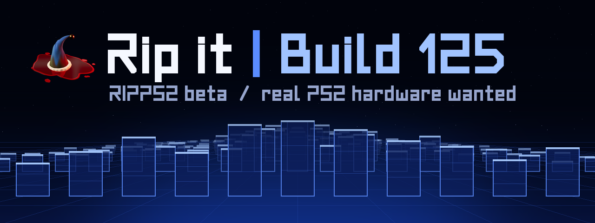
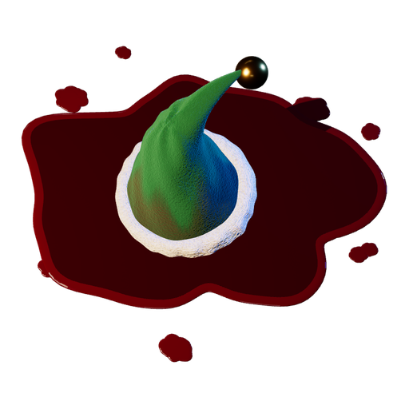

<p align="center"><sub><b>RIPPS2</b> &nbsp;&middot;&nbsp; <a href="https://github.com/akilluminati47/RIPPS2/releases/latest/download/RIPPS2.elf">Download</a> &nbsp;&middot;&nbsp; <a href="https://github.com/akilluminati47/BIBLE">BIBLE</a> &nbsp;&middot;&nbsp; <a href="https://github.com/akilluminati47/RIPPS2-themes">Themes</a> &nbsp;&middot;&nbsp; <a href="https://github.com/akilluminati47/RIPPCSX2">RIPPCSX2</a> &nbsp;&middot;&nbsp; <a href="https://github.com/akilluminati47/RIPPS2-fonts">Fonts</a> &nbsp;&middot;&nbsp; <a href="https://akilluminati47.github.io/RIPPS2/">Website</a> &nbsp;&middot;&nbsp; <a href="https://www.psx-place.com/threads/ripps2-a-ps2-front-end-in-one-elf-launch-disc-storage-memory-files.51316/">psx-place</a> &nbsp;&middot;&nbsp; <a href="https://discord.gg/ggkCDWqhE">Discord</a></sub></p>

<p align="center"></p>

# RIPPS2

> ### Rip it: RIPPS2 build 125, v1.2.5 beta
> **RIP PS2, the ELF killer.** ELF-sufficient, never ELF-destructive: your other ELFs stay safe on the [shelf](https://akilluminati47.github.io/RIPPS2/) (nothing is deleted unless you ask), they just get a well-earned rest.
> 1. **[Download RIPPS2.elf](https://github.com/akilluminati47/RIPPS2/releases/latest/download/RIPPS2.elf)** (always the newest release) (one file, 2,714 KB), and the **[theme pack](https://github.com/akilluminati47/RIPPS2-themes/releases/latest)** if you like (Adapt, Adapt Rx, edition 122: a config and one picture each; RIPGRID and RIPFLOW are built in), and **[RIPPS2-languages.zip](https://github.com/akilluminati47/RIPPS2/releases/latest/download/RIPPS2-languages.zip)** for RIPPS2 in your language (33 of them; every release carries it).
> 2. Copy it to a USB stick or memory card, and launch it from FreeMcBoot, PS2BBL, wLaunchELF or whatever you already use to start homebrew. In PCSX2: **System > Start File** and pick `RIPPS2.elf`.
> 3. Tell us how it went: [the psx-place thread](https://www.psx-place.com/threads/ripps2-a-ps2-front-end-in-one-elf-launch-disc-storage-memory-files.51316/), [an issue](https://github.com/akilluminati47/RIPPS2/issues), or **#RIPPS2** on the developers' Discord, [discord.gg/ggkCDWqhE](https://discord.gg/ggkCDWqhE) (invite good for October 2026).
>
> [What's new in build 125](https://github.com/akilluminati47/RIPPS2/releases/tag/v1.2.5-beta) | [Changelog](CHANGELOG.md) | **[Videos](#videos)** | [Every release](https://github.com/akilluminati47/RIPPS2/releases) | [Talk about it on psx-place](https://www.psx-place.com/threads/ripps2-a-ps2-front-end-in-one-elf-launch-disc-storage-memory-files.51316/)<br>
> [Theme RIPPS2](https://github.com/akilluminati47/RIPPS2-themes) (no rebuild, agent friendly) | [Fill your AUDIO and MEDIA folders](#the-sound-ripps2-was-made-with) with [RIPPS2 Media Studio](tools/media-studio) (sounds, music and video; [download it for Windows](https://github.com/akilluminati47/RIPPS2/releases/download/media-studio/RIPPS2-Media-Studio.zip)) | [See a theme in true 720p and 1080i: RIPPCSX2](https://github.com/akilluminati47/RIPPCSX2/releases/latest) (PCSX2 with HDTV output)

RIPPS2 is a PS2 front end in a single `.elf`: a teardown and rebuild of [RiptOPL](https://github.com/NathanNeurotic/Open-PS2-Loader) (the Open PS2 Loader fork), with rickgaiser's [Neutrino](https://github.com/rickgaiser/neutrino) inside as its second game core, and its own look, launchers, file browser and save tools. Glass towers stand behind your games and orbit formations behind your files, all drawn live by the PS2.

- **LAUNCH DISC** boots PS2, PS1 and DVD video discs, says which game is in the drive before you start it, and plays audio CDs with the towers turned into a spectrum analyzer. **RIPDISC** (build 105) rips the disc in the drive: a game to your storage, a CD or DVD video to your files.
- **STORAGE** is your game library: every drive in one list (All Games shows them all from the first frame, a drive that has not answered yet included), with art, an info page whose art crossfades with the screenshots, per-game settings, and R3 to star a game into Starred Games (the star sits at the start of the row; Settings > Game Sources > Starred Games Star moves or hides it; R3 held 4.2 s hides or shows every star). L2 + R2 jumps to a random game, and Recent Games keeps your last launches. Triangle on a game has **Hide Game**, **Delete** (the whole game: every part of the image, its CFG, art and cheats; its saves only if you say so), **Set Metadata (Rename)** and, for an ISO or ZSO, **Compress to ZSO** or **Uncompress to ISO** (experimental: the ISO stays until the ZSO has been read back and checked). Every drive's games show at once from its last list, then the drive is read again.
- **MEMORY FILES** is a built-in file browser: copy, move and delete across memory cards, USB, MMCE and the HDD (every copy read back and checked); open OPL's VMC card images like folders; export and import PSU saves; edit text files; open pictures, play AVI video **full screen** with **video player controls** (Cross plays/pauses, Circle stops, L1/R1 jump 10 s, L2/R2 volume, START loops; hints fade while it plays and stay while paused) ([RIPPS2 Media Studio](tools/media-studio) turns any video, a phone's MP4 included, into one), and play `.mp3`, `.ogg` and `.wav` files, or mark several and open them together to play them as one disc in Launch Disc's CD player; a **`.tar` is a blue folder** you can open, paste pictures into and copy members out of (build 125); Triangle on a `.tar` merges another ART `.tar` into it ([below](#covers-from-one-file-art-pack)). The **open folder is the first row**, showing its entry count, marked count, total size and the drive's free space; Cross or Square on it marks all (or, any marked, none). START opens its settings, where **SEARCH FILES** finds any file or folder by name on every started drive and opens the tree where it is. Square on a memory card opens the **CARD MANAGER** (back a card up to a VMC, write a VMC's saves back to a card, erase the game saves, format), and Square on the APA HDD the **HDD MANAGER** (its partitions, their sizes, and removing one after a full check of the partition table).

It is **beta** from build 100: a hundred builds of alpha, tested on consoles and in PCSX2 by ripto, nuno6573, zackcage6, eliminator1403, FifthFox and Mr.sus.60, and in the beta by lukeatmynose and ahavasi too, and by everyone testing on Discord, with special thanks to all the YouTube love as well. Keep your usual loader close by, and tell us what breaks: feedback is what makes RIPPS2. **The best way to get RIPPS2 updated is [an issue on GitHub](https://github.com/akilluminati47/RIPPS2/issues)**: DarkNerdShawny has opened three, and v1.1.7's FreeMcBoot fix came from one. Be like DarkNerdShawny.

## Videos

| Video | Length | What it shows |
| --- | --- | --- |
| [The v1.1.5 Short](https://akilluminati47.github.io/RIPPS2/media/b115/ripps2-v115-short.mp4) (on GitHub) | 0:39 | The CD player for your own tracks, Fast Boot, where rips go, Set Metadata (Rename) |
| [The v1.1.4 reel](https://youtu.be/UwuKWfRtUEs) | 7:55 | Everything in v1.1.4, with chapters in its description |
| [The v1.1.4 wheel Short](https://youtube.com/shorts/iQqR9lsar9Q) ([or on GitHub](https://akilluminati47.github.io/RIPPS2/media/b114/ripps2-v114-wheels-short.mp4)) | 1:10 | The wheels you hold SELECT for |
| [The v1.1.2 sounds walkthrough](https://akilluminati47.github.io/RIPPS2/media/b112/ripps2-v112-sounds.mp4) (on GitHub) | 2:11 | Every sound ripped from the console, in one take, from the boot sound to a game launching |
| [The v1.1.0 reel](https://youtu.be/Q8ZLd6ArV8s) | 3:57 | v1.1.0, cut to Over the Rainbow |
| [The beta reel](https://youtu.be/LPjdK_E1jjM) | 9:45 | The first beta, v1.0.0: the web page RIPPS2 started as, then your games, your files and what is on board |
| [The build 99 Short](https://www.youtube.com/shorts/Ov5iA-tMcI8) | Short | The last alpha |
| [The build 88 Short](https://www.youtube.com/shorts/Sqprz22tdtg) | Short | Build 88, set to Slideshow |
| [The build 83 reel](https://youtu.be/A27N9s6tumk) and [its Short](https://youtube.com/shorts/4QBe5UO2KxM) | | Build 83, alpha |
| [The build 55 reel](media/ripps2-b55-reel.mp4) and [build 22's demo](media/ripps2-b22-demo.mp4) (on GitHub) | | The early alphas |

## Highlights

- **Themes you can make your own.** Frosted glass panels over each game's art, a cover **Grid** element, right-stick tilt that moves a whole page as one sheet, and the first pack, **[RIPPS2-themes](https://github.com/akilluminati47/RIPPS2-themes)**: Adapt and Adapt Rx, each config opening with a glossary of every key, with a checker and a key reference for anyone (or any agent) making more. RIPGRID and RIPFLOW are built in, and themes made for Open PS2 Loader work as they are. Hold **SELECT** for 4.2 seconds on a game list and your themes open in a panel to pick from (Settings > Interface > Hold SELECT: List, Cycle for the next theme, or Off). On RIPGRID and RIPFLOW, hold the right stick to one side for 0.42 s and the chosen case turns over to its back cover, and the grid turns its pages with a slide.
- **The categories where you want them.** Settings > Interface > Layout > Category Layout: LAUNCH DISC, STORAGE and MEMORY FILES as names **Across the Top**, as icons down a **Sidebar** (Classic or XL; Left on a list or Circle opens it, and each category has a drawer of its pages), or **Menu**: no bar, the categories in the START menu, as a theme made for OPL has them. On Theme the theme decides: a theme made for OPL gets Menu, Adapt the sidebar.
- **RIPFLOW**, the built-in cover carousel (and RIPGRID, built in too), and a launch disc as a game starts (Layout > Launch Disc): **Pop In**, **Spin**, or **Zoom**, which grows the disc until it reads clearly and holds it there (RIPFLOW's and Adapt's default), or Off. **Hints and Glyphs** (Interface): your own hint layout and order, badges, and four glyph sets (the theme's, RIPPS2's, Standard and White). **Colors and Text** (Interface): ten Color Themes (RIPPS2, Ember, Blood, Ectoplasm, Amethyst, Bone, Tangerine, Flamingo, Turquoise, Moonlight) or Custom, a **Color Sweep** that fades through five colors (Rainbow, one made from each Color Theme, or up to four of your own), and Text Weight. Layout has fading hints and category bar, and the source name popped in big in the middle of the page. Themes can pick all of it for themselves, and your own settings always win.
- **What it needs, on board; what you have, found.** [Neutrino](https://github.com/rickgaiser/neutrino) (its newest build) and BIBLE ride inside the one `.elf` and install themselves where you pick; your own POPSTARTER, POPS files and Ember are searched for on your drives once, remembered, and launched from where they are. **STATUS** on the START menu shows every drive, where each launcher was found (LOOK FOR THEM searches again), the homebrew, BIBLE and your sounds, and **SAVE DIAGNOSTICS** writes `DIAG.TXT` for a bug report.
- **A fast boot.** Settings > Game Sources > Cache > **Fast Boot** reads only RIPPS2's own drive at boot: the settings and sounds beside `RIPPS2.ELF`, and every list from its cache. The other drives wait until you press SELECT on their page or pick one of their games. A game picked while RIPPS2 is still reading or writing waits for it behind a panel that says what is left (START NOW goes at once), so a launch never cuts a write short.
- **Your settings where you want them**: Settings > General & System > Save Settings To keeps them in RIPPS2's save on a memory card, in a RIPPS2 folder on the internal HDD (exFAT, or the APA HDD's OPL partition), a USB drive, MX4SIO, iLink or MMCE (read first at boot), or in a folder you type.
- **The picture where your TV wants it.** Settings > Interface > Screen: Video Mode (up to 720p and 1080i), Widescreen, and H-POS, V-POS and Overscan, which from build 124 are kept for each video mode, so 1080i and 480i each keep their own centering.
- **BIBLE and BOOT LOCK.** Settings > General & System > Boot Loader shows what each memory card starts at power on and installs **BIBLE**, PS2BBL 1.2.0 set up for RIPPS2, on a memory card. **Boot Lock** sets the boot loader your console really starts so it starts RIPPS2: PS2BBL and FreeMcBoot start it at once, OSDMenu puts it first in its menu, and turning it off puts back what was there before.
- **An in-game menu** (Settings > Game Launching > In-Game Menu, on by default): L1+L2+R1+R2+SELECT+START pauses a game, silent, over its own picture, under Resume, Exit Game, **Screenshot** (RIPSHOT, [below](#screenshots-in-game-ripshot)), Achievements and Power Off (a second press turns the PS2 off right there); RESUME gives back the exact frame, and Achievements lists what you have left to hunt and how to earn it. **Exit Game goes through the console's own boot path:** with the IGR Path on that page empty (the default), the reset goes to the browser, which starts your boot loader (FreeMcBoot, PS2BBL, OSDMenu or BIBLE) when one is installed, and RIPPS2 again with Boot Lock on, the way the console starts at power on; with none, the PS2 browser. From v1.2.1 that is never a black screen: an IGR Path is used only when the reset can load it (an ELF on a memory card or a FAT32 USB drive) and it is not RIPPS2 itself, and STATUS says when one is passed over.
- **Achievements** (SpiritofRA): RetroAchievements telemetry through the [xeRAbora](https://github.com/hacan359/xerabora) client on your PC (pinned to [v0.1.0-alpha.18](https://github.com/hacan359/xerabora/releases/tag/v0.1.0-alpha.18)), badges on tracked games, the disc in the tray, and **YOUR ACCOUNT**, every game you have checked with what you have unlocked and, with xeRAbora open to the network, **LEFT TO HUNT**: every locked achievement and how to earn it.
- **Cover Art** (Settings > Network) downloaded by the PS2 itself for every PS2 game that has none, from xlenore's ps2-covers on GitHub (it needs the network cable and the internet): choose **HD** (280 × 400, sharper on an HD screen) or **Standard** (140 × 200, as Open PS2 Loader's), both 8-bit with dithering; a game that already has a cover keeps it (build 125). **720p and 1080i** drawn in one pass: a frame 640 pixels wide with every line of the mode, stretched across the screen by the console's own display circuit, so every animation keeps its speed. **RIPFLOW shows five covers on a 16:9 picture** (720p, 1080i, or Widescreen on) and three on 4:3, widening automatically unless you pick a count (build 125). Your **AUDIO** folder found on any drive, and towers and orbs that run all night at a steady 60 fps.
- **Guard rails**: every build runs RiptOPL's host checks and RIPPS2's own, and a new warning in a RIPPS2 file fails it.

## In your language

From build 104 every word RIPPS2 shows translates, its own pages and hints as well as Open PS2 Loader's settings. Each build comes with **`RIPPS2-languages.zip`**: copy its `LNG` folder to the top of a USB drive, the HDD's OPL partition or an MMCE card (or the files in it to `mc0:/RIPPS2`), then pick the language in **Settings > Interface > Language**. 33 languages read RIPPS2 whole, from French, Spanish, German and Portuguese to Russian, Greek, Turkish, Vietnamese, Lao, Chinese, Japanese and Korean, and Arabic and Persian right to left with their letters joined; a language that needs other letters has its font in the pack beside it. Corrections and new languages go in [`elf/lang`](elf/lang) (one `<Language>.yml` each; `python3 elf/lang/ripps2lang.py check` checks them).

<p align="center">


</p>

## Rip a disc

Put the disc in the drive and open **LAUNCH DISC**. After a few seconds a glass panel offers **RIPDISC**: hold **SELECT** until its ring fills. The next step says what the disc is, its size, **how long it should take** and where it goes; confirm, then **START**.

- **A PS2 game** becomes an ISO in a drive's DVD or CD folder, in your games list. A game over 4 GB going to a FAT32 drive is saved as Open PS2 Loader's 1 GB parts with ul.cfg instead; on an exFAT drive (a USB stick, MX4SIO, iLink or the internal HDD) it stays one ISO. The room on the drive is checked before the rip starts.
- **A PS1 game** becomes a BIN and CUE in `EMBER/games/<Title>/`, played with Ember.
- **An audio CD or a DVD video** goes to your files: Memory Files opens on **MEDIA** (beside AUDIO) with the disc on the clipboard as **RIPPED**; PASTE in any folder rips it there. A CD lands as WAVs (copy one into AUDIO and it is in your menu music), a DVD you made as its VIDEO_TS files. Bought films are copy protected and the drive will not read them.

The PS2's USB is slow (USB 1.1, about 1 MB a second): a full DVD to a stick takes over an hour, to the internal exFAT HDD a fraction of that. The estimate learns your console's own speed from your first rip.

<p align="center">


</p>

## Screenshots in game (RIPSHOT)

In a game, L1+L2+R1+R2+SELECT+START, then **SCREENSHOT**: the frame that was on screen when the menu opened, with no menu in it. Pick **ART** (the game's screenshot art, 250 x 188, `_SCR`, `_SCR2`...), **MEDIA** (full size, in a folder named for the game) or **BOTH**; each shows the file it becomes, its size and the shots left. **SAVE** fades the menu off, **KEEP** or **DELETE** decides.

Shots wait on the game's roll in `MEDIA/RIPSHOT` (6 a game) until they are developed into 8-bit PNGs: by hand from Memory Files (open `MEDIA/RIPSHOT`: VIEW a shot, ACTIONS to develop it), or by themselves in the background with **Develop Shots: Auto** (Settings > Game Launching > In-Game Menu). Themes show every shot a game has with the `SCRn` key: RIPPS2's info page slideshow, RIPGRID, RIPFLOW and Adapt do. RIPSHOT works for games on USB, the internal exFAT HDD, MX4SIO, iLink and, from build 117, MMCE (an SD2PSX's SD keeps the rolls); games on the APA HDD come in a later build.

<p align="center">


</p>
<p align="center">


</p>

## Your own sounds and music

Put an `AUDIO` folder beside `RIPPS2.elf`. It takes sound effects as `.adp` files named for their events (RiptOPL's `boot`, `cancel`, `confirm`, `cursor`, `message`, `transition`, `bd_connect`, `bd_disconnect`, and RIPPS2's `page_in`, `page_out`, `error`, `save`, `launch`, `disc`, `random`), and music as any `.ogg` (Ogg Vorbis without tags), 16-bit `.wav` or (from build 115) `.mp3`: `bgm_01 Title.ogg`, `bgm_02 Title.ogg` set the order and the title, and since build 105 any other name is listed as it is, so a track ripped from a CD needs no renaming. Settings > Audio > Music picks the track. RIPPS2 writes a `README.txt` into AUDIO (and MEDIA) saying all of this. **[RIPPS2 Media Studio](tools/media-studio)** does all of it on your PC (and turns your videos into the AVI Memory Files plays): browse to any sound or song, hear it as it is and as the PS2 will play it, convert it (or a whole folder) into `output/AUDIO`, and copy that folder beside `RIPPS2.elf` with a USB stick and RIPPS2's Memory Files. Point it at the BIOS dump of your own PS2 and it renders the console's own menu sounds and system music from it, ready to use. (`elf/theme/tools/make_adp.py` and `make_sound_pack.py` still do the same from the command line.) RIPPS2 ships no sounds or music at all: since build 95 it has none built in, so without an `AUDIO` folder it is silent, and **STATUS > SOUNDS** says what it found.

**Where AUDIO and MEDIA go.** Keep `AUDIO` beside `RIPPS2.elf`, on the drive RIPPS2 starts from: the boot reads it first, and with **Fast Boot** on (Settings > Game Sources > Cache) the boot sound is read with the settings, before the drives and lists start, so it is already playing as the towers' first frame appears (from build 118). RIPPS2 on a memory card with `AUDIO` on a drive: after **BIOS Sounds > Rip**, START copies just `boot.adp` (about 360 KB) beside RIPPS2 on the card, so the boot sound plays as the pillars rise instead of once the drive is up (from build 121). Keep only what the menus play there. `MEDIA` (ripped CDs and DVD videos, full-size shots) is for your biggest drive: nothing in it is read at boot, so how fast that drive reads matters little.

### The sound RIPPS2 was made with

RIPPS2 is voiced like a PS2 that never left the living room: **Sony's own console sounds**, Sony system music, and **one Nintendo track** to browse by (the RIPPS2 designer's own picks). None of it ships with RIPPS2; **[RIPPS2 Media Studio](tools/media-studio)** gets you there from the [BIOS dump of your own PS2](https://pcsx2.net/docs/setup/bios/) (the file PCSX2 uses) and your own copies of the music. Its **Start** rips the console's sounds into a full `AUDIO` folder; this is the map they go into. Or skip the PC: **Settings > Audio > BIOS Sounds > Rip** writes the console's own sounds straight into `AUDIO`: the menu sounds, and (since build 89) the boot and game launch music played from the BIOS's own notes. BIOS Music beside it rips the menu music, the clock's piece (or the red screen's, or both: build 112). **[The v1.1.2 sounds walkthrough](https://akilluminati47.github.io/RIPPS2/media/b112/ripps2-v112-sounds.mp4)** plays every one in a single take, from the boot sound to a game launching.

| | Moment | `AUDIO` file | Sony's sound, from your own PS2 (Media Studio > Your BIOS) |
|:-:|---|---|---|
| ▶ | Boot, as the towers rise | `boot.adp` | the **boot** ("Bootup") |
| ◆ | Into an info page or Settings | `page_in.adp` | **Menu sound 3** |
| ◇ | Back out to the list | `page_out.adp` | **Menu sound 2** |
| ↕ | Cursor | `cursor.adp` | **Menu sound 7** |
| ✕ | Confirm | `confirm.adp` | **Menu sound 5** |
| ○ | Cancel | `cancel.adp` | **Menu sound 13** |
| ⇄ | Launch Disc, Storage, Memory Files | `transition.adp` | **Menu sound 10** |
| ✉ | A message, a disc read | `message.adp`, `disc.adp` | **Menu sound 11** |
| ✓ | Save | `save.adp` | **Menu sound 12** |
| ! | Error | `error.adp` | **Menu sound 4** |
| ★ | Game launch | `launch.adp` | the **PS2 logo** ("Game Boot") |
| ◀ | Drive plugged in | `bd_connect.adp` | **Menu sound 8** |
| ▷ | Drive removed | `bd_disconnect.adp` | **Menu sound 9** |
| ⚄ | Random game (L2 + R2) | `random.adp` | **Menu sound 6** |

<sub>Menu sounds are numbered as Media Studio lists an SCPH-39001 dump. Start already puts most of them in place; for this map, convert save, error, random and the two drive sounds from the menu sounds named here.</sub>

| Music | Track | From | Get it |
|---|---|---|---|
| `bgm_00 Menu.wav` | **Menu** (the clock, 5:04) | PS2 system music (Sony): the browser's main menu, the piece the clock plays | Rip it in RIPPS2: **Audio Settings > BIOS Music > THE MENU MUSIC** (from your console's own BIOS). It plays when no other track is picked |
| `bgm_01 Red Screen.wav` | **Red Screen** (the disc warning, 5:31) | PS2 system music (Sony): the red "insert a disc" screen's piece | Rip it in RIPPS2: **Audio Settings > BIOS Music > THE RED SCREEN MUSIC** (BOTH in the same list rips the menu's and the red screen's one after the other, each its own file) |
| `bgm_01 Slideshow.ogg` | **Slideshow (Daytime)** | the Wii's [News Channel](https://en.wikipedia.org/wiki/News_Channel_(Wii)), by [Kazumi Totaka](https://en.wikipedia.org/wiki/Kazumi_Totaka) (Nintendo, 2006): the suggestion RIPPS2 was paced to, and **the background music of RIPPS2's videos on YouTube** (the beta reel, the build 83 reel and Short, the build 88 Short) | your own copy, converted on your PC with [RIPPS2 Media Studio](tools/media-studio) |
| `bgm_02 Details.ogg` | **Details** | x-Radar Portable, [PSP system music](https://en.wikipedia.org/wiki/PlayStation_Portable_system_software) (Sony, 2010): **the background music of RIPPS2's videos on YouTube** with Slideshow (the beta reel opens with it, and the build 83 reel and Short) | your own copy, converted on your PC with [RIPPS2 Media Studio](tools/media-studio) |

## Covers from one file (ART Pack)

From build 118, **Settings > Game Sources > Cache > ART Pack** packs the `ART` folder of every started drive into one `art.tar` in the `ART` folder of the drive you pick. RIPPS2 measures how fast each drive reads its own art and lists the fastest first, so X takes it (an SD2PSX's SD, say). The pictures go in as they are (PNG and JPG are compressed already: the tar only bundles them, and a PC opens it as any tar), and the `ART` folders are left alone. From then on covers load from that one file through one index (written with the pack, so the first boot needs no scan of it), and a game the pack was built for never has its `ART` folder asked one picture at a time, missing pictures included: less reading on the drive the music streams from, and art that keeps up with the cursor. Art RIPPS2 fetches or shoots later shows at once; art you copy in on a PC shows after you build the pack again. You can copy `art.tar` into another drive's `ART` folder with Memory Files, but build it on the drive you browse from. The same button removes the pack.

**Merge one `.tar` into another** (build 123). Pack a big drive once as the master, then later pack only the new games' art and merge that small `.tar` into it, instead of packing every ART folder again. In Memory Files, Triangle on a `.tar` > **MERGE A .TAR INTO THIS**: that `.tar` is the one kept, and RIPPS2 lists the others to merge in (in that folder, in each started drive's ART folder and at its top). Cache > ART Pack offers the same for the pack in use, and right after a pack is built. A picture in both comes from the merged-in `.tar`, and the two lists of games become one. The merge is written beside the kept `.tar` and only takes its name once every byte is on the drive, so a stop, a full drive or a pulled card leaves the kept one as it was. At the end a box names both files and asks whether to delete the merged-in one (START deletes it, Back keeps it); the kept one is never offered.

## Your hardware

- **Network adapters and the internal HDD.** RIPPS2 drives every network adapter with the PS2SDK's own DEV9 driver, the one current loaders use, and it tells the two kinds apart by itself: the expansion bay adapters of the fat consoles (SCPH-10281, SCPH-10350, and the IDE and SATA adapters made from them) and the slim's built-in port, and the PC CARD adapter of the first Japanese consoles (SCPH-10000 to 18000). There is no legacy driver to choose. The HDD is read the same way whether it is APA or exFAT, and an HDPro adapter gets its own driver. SMB games, UDPBD and the art download all use the same adapter. If yours does not show up, post the adapter's and the console's model.
- **VMCs (virtual memory cards).** A game's own settings (its VMC rows) give it a card image in the `VMC` folder of the game's drive, in slot 1 or 2. With the OPL core they work on USB, MX4SIO, iLink, the exFAT HDD, the APA HDD, SMB and MMCE; on a FAT32 or exFAT drive the card has to be one unbroken file, which RIPPS2 makes new ones as, and **Rebuild** fixes an older one that is not. With Neutrino they work on USB, MX4SIO, iLink and the exFAT HDD, but not on the APA HDD, where the game uses the real card in that slot. An SD2PSX can also give every game a card of its own by itself (GameID in its settings), with no VMC at all.
- **Neutrino.** RIPPS2 carries Neutrino's newest build and installs it the first time a game needs it. Your own Neutrino comes first, whatever its version: put its `neutrino` folder on the game's drive or a memory card, or give its path in Settings > Game Launching > Neutrino Defaults, and RIPPS2 sends it only the options that version knows. From 1.1.5 it is told the right drive number when RIPPS2 started from a USB drive and the game is on the internal exFAT HDD (that mix made Neutrino quit and the console restart).
- **Apps such as SMS.** An app starts from its own path. SMS (Simple Media System) reads only that, so RIPPS2 cannot hand it a file to play; if a version of SMS takes one, RIPPS2 will pass it.

## How it is built

`elf/build.sh` takes RiptOPL at the commit named in `elf/RIPTOPL_REF`, applies the patch series in `elf/patches`, adds the RIPPS2 theme, fonts and art from `elf/theme`, and builds `RIPPS2.elf`. GitHub Actions runs it on every push ("Build RIPPS2.elf"); the ELF is the run's artifact.

## The web version

RIPPS2 started life as a web theme, and that version is still here: **live demo** at https://akilluminati47.github.io/RIPPS2/

| Option | Opens |
| --- | --- |
| **Launch Disc** | The pillars, with a double blast fired into the center of the field |
| **Storage** | The elf shelf, standing in front of the pillars |
| **Memory Files** | The orbs |

The PS2 mark rides under the selected option and flies between them: a swoop to a neighbor, a deeper dive with a coin flip when going end to end. Labels follow the visitor's system language (18 languages, override with `?lang=fr` and similar). Anything the menu font cannot draw falls back to a clean sans as a whole word.

**Elf shelf:** Storage's showcase. uOPL's wooden plank in front of the towers, and on it the RIPPS2 mark ten times over: a dead elf's felt hat standing brim-down in its own pool of blood, one for each Color Theme (RIPPS2, Ember, Blood, Ectoplasm, Amethyst, Bone, Tangerine, Flamingo, Turquoise, Moonlight). Three show at a time, the way RIPFLOW shows covers: the middle one turns to watch the pointer (the nearer it is, the quicker it turns) and bobs on its spring, and Left / Right or a touch on either neighbor turns the shelf. It lands on the blue RIPPS2 hat. A hat pressed sends its Color Theme across the towers (the ELF's own colour matrix, so the towers look as that theme makes them): a tap is a burst of colour crossing the field and washing back to RIPPS2's blue; held, the theme stays over the whole render until it is let go.

**Phones held upright** (`letterbox.js`): the site plays in a letterboxed player at the top of the screen, with only the camera's and the curved corners' inset above it, laid out as on a landscape screen and scaled to fit. Under it, an arrow up to the player, a glowing note to pinch to zoom or turn the phone sideways, and a switch between a 16:9 and a 4:3 box (remembered); a footnote in the bottom-right corner reads RIPPS2 (vision interactive mock-up). Turning the phone sideways goes back to the full page, on whichever page the player was showing. `?letterbox=1` shows the player on a desktop.

**Pillars:** glass data towers with glowing edges, seams, flickering cells and energy pulses, on a reflective floor. Towers rise out of the ground on load, then breathe and ripple; the pointer sends ripples and a click sets off a blast. Adapts resolution on slow devices, pauses off screen, respects reduced motion.

**Orbs:** twelve formations (Browser Orbit, Borromean Rings, Torus Orbit, Icosahedron, Double Helix, Strange Attractor, Trefoil Knot, Mobius Strip, Klein Bottle, Golden Spiral, Lissajous and Seven-Point Star), each with as many orbs as it needs, splitting and merging between them. As in the ELF's Memory Files, each shape's outline draws on with a flash when the tab opens and each time a formation settles, holds about two seconds and fades. Press and hold the scene (or hold `L`, or a controller's L2 or Cross) for the whole path, steady; drag while holding to turn the formation, which slides to a stop when let go (a controller's right stick turns it too). Switch with a swipe, the Left / Right glyphs beside the name, the arrow keys, or a controller's d-pad or bumpers.

To run it locally, serve the folder (ES modules need a web server) and open http://localhost:8000:

```bash
python -m http.server 8000
```

Add `?t=12` to skip the pillars intro, or `?f=3#memory-files` to open a specific formation (old `orbs.html` links land on Memory Files).

## Credits

RIPPS2 is designed and directed by akilluminati47 and built with Claude (Anthropic). Testers: ripto, nuno6573, zackcage6, eliminator1403, FifthFox, Mr.sus.60, lukeatmynose, ahavasi, and everyone testing on Discord. Issues on GitHub: DarkNerdShawny and everyone who opens one (an issue is the best way to get RIPPS2 updated: be like them and [open one](https://github.com/akilluminati47/RIPPS2/issues)). Special thanks to all the YouTube love as well: glad to help however you reach me.

- [RiptOPL](https://github.com/NathanNeurotic/Open-PS2-Loader) by NathanNeurotic and the [Open PS2 Loader](https://github.com/ps2homebrew/Open-PS2-Loader) team (AFL-3.0), which RIPPS2 is built on. Their full credits are on RIPPS2's About page.
- [Neutrino](https://github.com/rickgaiser/neutrino) by [rickgaiser](https://github.com/rickgaiser) (AFL-3.0), the small, fast and modular device emulator that is RIPPS2's second game core: RIPPS2.elf carries its newest build (v1.8.0-61-g7be8de2, 31 August 2026) unmodified and installs it where you pick, and your own Neutrino of any version comes first ([`elf/neutrino`](elf/neutrino/README.md)). Choose it as the Default Loader Core in Settings > Game Launching.
- [xeRAbora](https://github.com/hacan359/xerabora) by [hacan359](https://github.com/hacan359): the RetroAchievements PC client and the RetroAchievements code on the console side that RIPPS2 inherits through RiptOPL (MIT / AFL-3.0). **LEFT TO HUNT** reads the interface page's `GET /state` on port 18280, which is not part of the documented console protocol and can change between alphas, so RIPPS2 is pinned to **[v0.1.0-alpha.18](https://github.com/hacan359/xerabora/releases/tag/v0.1.0-alpha.18)**, the release its author recommends (alpha.10 is unstable, and the `checked_only` key LEFT TO HUNT reads is in `/state` only from alpha.11 on); checked against that release's `/state` code, other versions are untested.
- [ESR](https://gitlab.com/ffgriever/esr/) by ffgriever: Launch Disc starts your own copy for ESR discs.
- [Ember](https://github.com/Gageformer/Ember/releases) by Gageformer, the PS1 emulator for the PS2: RIPPS2 launches your own `ember.elf` from the `EMBER` folder of the drive your games are on (builds 71 to 112 carried its Beta-2 build; [`elf/ember`](elf/ember/README.md)). Bring your own PS1 BIOS.
- [POPSTARTER](https://www.psx-place.com/resources/popstarter.683/) by krHACKen starts PS1 games from your own copy, which RIPPS2 finds on your drives and memory cards ([`elf/popstarter`](elf/popstarter/README.md)).
- [PS2BBL](https://github.com/israpps/PlayStation2-Basic-BootLoader) by El Isra (israpps) and [PS2BBL Extended](https://github.com/saildot4k/PlayStation2-Basic-BootLoader-Extended) by saildot4k: BOOT LOCK edits their config so the console starts RIPPS2 (from build 116, FreeMcBoot's and OSDMenu's too). From build 69, RIPPS2.elf carries El Isra's signed PS2BBL 1.2.0 unchanged, as data, for **Boot Loader > Manage** (BIBLE) to install on a memory card. PS2BBL is GPL-3.0: its license and the exact source it was built from ([commit a063bb3](https://github.com/israpps/PlayStation2-Basic-BootLoader/tree/a063bb3)) are in [`elf/bible`](elf/bible/README.md). The card binding uses ps2sdk's open SECRMAN (AFL); no keys are involved.
- **MMCE cards**: [sd2psXtd](https://sd2psxtd.github.io/) firmware on an SD2PSX, such as the [SD2PSXTD](https://github.com/LinkRetro/SD2PSXTD-Hardware) card, read through [mmceman](https://github.com/ps2-mmce/mmceman) (ps2-mmce): games, VMCs and settings on the card's SD. **Keep the firmware up to date** ([sd2psxtd.github.io/download](https://sd2psxtd.github.io/download)). Compressing a game on the card needs sd2psXtd 1.4.0 or newer (it renames the finished image into place); RIPPS2 asks the card first, so older firmware is told before anything starts and cannot compress there. The card cannot report its free space, so even on 1.4.0 there is no room check before compressing: leave space for the game and its ZSO side by side (if the card fills, the work stops and removes what it wrote).
- [wLaunchELF](https://github.com/ps2homebrew/wLaunchELF) by the ps2homebrew team, and wLaunchELF R3Z by NathanNeurotic: the behavior references for the Memory Files browser and its settings grid.
- [Apollo Save Tool](https://github.com/bucanero/apollo-ps2) by bucanero: the reference for the save tools (PSU, card images). RIPPS2's own code, written from the formats.
- [ps2sdk](https://github.com/ps2dev/ps2sdk) by the ps2dev team: the memory card file system (mcman) and the USB keyboard driver.
- mymc by Ross Ridge and [mymcplus](https://github.com/thestr4ng3r/mymcplus) by Florian Maerkl: what RIPPS2's card image writes are checked against.
- [minimp3](https://github.com/lieff/minimp3) by lieff (CC0 1.0, public domain): MP3 playback in Memory Files and AUDIO, from build 115, unchanged in RiptOPL's `thirdparty/minimp3`.
- Planet N Compact by [Iconian Fonts](https://www.iconian.com) (`assets/master.ttf`), and Planet N Condensed (`elf/theme/fonts/ripps2_condensed.ttf`, built in from build 115 as `builtin:ripps2condensed`, Adapt's list face). [RIPPS2 Sleek](https://github.com/akilluminati47/RIPPS2-fonts) (Regular, Bold, Bold Case) is drawn for RIPPS2; its own repo has the fonts as TTF and WOFF2 under the OFL.
- Web version: [three.js](https://threejs.org) r160, MIT (see `vendor/LICENSE`); [Albert Sans](https://github.com/usted/Albert-Sans), SIL Open Font License (see `vendor/fonts/OFL.txt`).
- The web mockup's elf shelf (Storage, [akilluminati47.github.io/RIPPS2](https://akilluminati47.github.io/RIPPS2/)) stands on the wooden plank from [uOPL](https://github.com/SlimPugGamer/uOPL) (`gfx/plank.png`, AFL-3.0).
- The RIPPS2 mark, the dead elf in its blue hat, is original: rendered in three.js (MIT) from `media/deadelf/scene.html` (every angle and color in `media/deadelf`), with a vector version in `assets/ripps2-deadelf.svg`.
- The build 83 reel and Short (on YouTube) are set to Details (x-Radar Portable, PSP system music, Sony), Slideshow (Daytime) by Kazumi Totaka, from the Wii News Channel (Nintendo, 2006), and the PS2's own Menu theme (Sony); the build 66 reel to Slideshow (Daytime); the build 55 reel's music is original. Game art seen in testing came from the community OPL art database and is not part of RIPPS2.

Unofficial fan project. PlayStation, PS1, PS2, the PlayStation logo and the PS2 logo are trademarks of Sony Interactive Entertainment. This project is not affiliated with or endorsed by Sony.

<p align="center"></p>

<p align="center"><sub><b>RIPPS2</b> &nbsp;&middot;&nbsp; <a href="https://github.com/akilluminati47/RIPPS2/releases/latest/download/RIPPS2.elf">Download</a> &nbsp;&middot;&nbsp; <a href="https://github.com/akilluminati47/BIBLE">BIBLE</a> &nbsp;&middot;&nbsp; <a href="https://github.com/akilluminati47/RIPPS2-themes">Themes</a> &nbsp;&middot;&nbsp; <a href="https://github.com/akilluminati47/RIPPCSX2">RIPPCSX2</a> &nbsp;&middot;&nbsp; <a href="https://github.com/akilluminati47/RIPPS2-fonts">Fonts</a> &nbsp;&middot;&nbsp; <a href="https://akilluminati47.github.io/RIPPS2/">Website</a> &nbsp;&middot;&nbsp; <a href="https://www.psx-place.com/threads/ripps2-a-ps2-front-end-in-one-elf-launch-disc-storage-memory-files.51316/">psx-place</a> &nbsp;&middot;&nbsp; <a href="https://discord.gg/ggkCDWqhE">Discord</a></sub></p>
