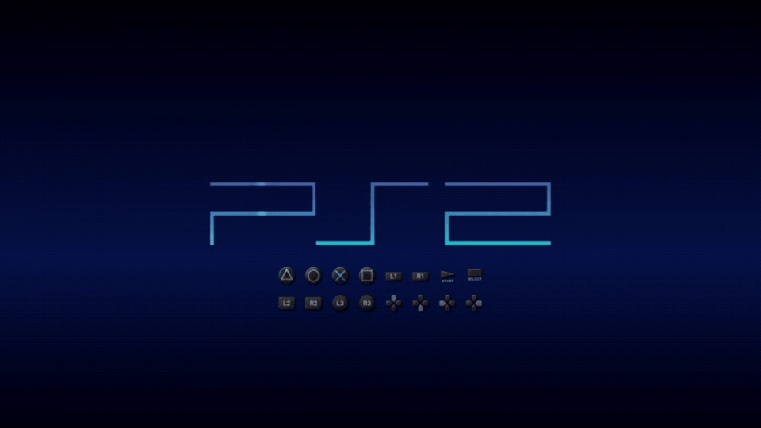
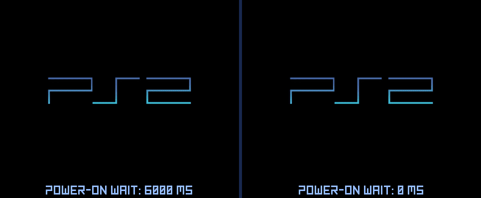
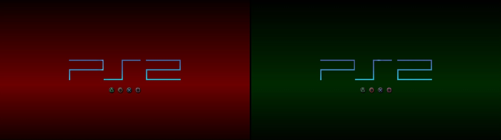

## BIBLE 3282396, signed by akilluminati47: the background, and the boot sound for RIPPS2

BIBLE is akilluminati47's boot loader, built on [PS2BBL](https://github.com/israpps/PlayStation2-Basic-BootLoader) by El Isra and [PS2BBL Extended](https://github.com/saildot4k/PlayStation2-Basic-BootLoader-Extended) by saildot4k (GPL-3). **All four builds here were signed by akilluminati47**, with kelftool on their own PC.

**Using RIPPS2? You do not need anything from this page.** [RIPPS2 v1.3.9-beta](https://github.com/akilluminati47/RIPPS2/releases/tag/v1.3.9-beta) carries these files inside RIPPS2.elf. With BIBLE on a card, **Settings > General > Boot Loader > Manage** opens a BIBLE menu: **UPDATE BIBLE** binds this one over an older one, and Background, Splash, Button Glyphs, Info Line, Power-on Wait, Video Mode and Widescreen set BIBLE's settings file for you. This page is for other installers (KELFBinder).

### What is new since `signed-a1ffb0b`
- **`BIBLE_BACKGROUND`**: `AUTO` (the default: RIPPS2's sky when BIBLE starts RIPPS2 and finds its settings, else black in the console's own mode, a plain boot loader), `SKY` or `BLANK` (black). RIPPS2's settings are also read from `mc?:/RIPPS2` when BIBLE starts RIPPS2 from an SD2PSX, USB or the HDD.
- **The boot sound, primed for RIPPS2**: RIPPS2's Boot Sound On (fast) keeps `boot.adp` beside BIBLE's settings (`mc?:/SYS-CONF/boot.adp`). It is read before any drive starts. BIBLE can also hand it to RIPPS2 in memory, but that has only passed in the lab: on a real SD2PSX, RIPPS2 read the card's copy itself. No `boot.adp` is the fastest boot. [How it works](https://github.com/akilluminati47/BIBLE/blob/main/docs/boot-sound-handoff.md).
- **RIPPS2 first**: the built-in defaults and the config template try `mc?:/RIPPS2/RIPPS2.ELF` and `mmce?:/APPS/RIPPS2.ELF` before OSDMenu and FMCB.

Background Black, no buttons, video mode AUTO. PCSX2, RIPPS2 on a memory card; the same 6.5 s of black load is cut from both sides, so the 6 s between them is real. The 0 ms side also has <code>DISC_STOP = 0</code>: BIBLE then leaves the disc drive alone at launch instead of waiting for it, 3.3 s saved here.

Background Auto: your RIPPS2 Color Theme's sky when BIBLE starts RIPPS2. Here Blood and Ectoplasm, in 1080i.

### Tested
| What | Where | Result |
|---|---|---|
| Signing | akilluminati47's PC, kelftool (memory card builds: dnasload, HDD build: fhdb) | All four signed by akilluminati47 on 11/03 |
| Background and the boot sound hand-off | PCSX2 (memory card and MMCE builds) | Sky from RIPPS2's settings, black for another AUTO, BLANK forced; the sound reaches RIPPS2 with its CRC intact |
| MMCE build, bound by RIPPS2 1.3.9's UPDATE BIBLE over `a1ffb0b` | SCPH-39001 (USA, fat), SD2PSX BOOT card in slot 0 | Bound; at power on its splash, then RIPPS2 |
| The boot sound on that console | SCPH-39001 (USA, fat), SD2PSX BOOT card in slot 0 | Not handed over: `DIAG.TXT` says "no boot sound handed over" and RIPPS2 read the card's copy itself; the sound still plays |

### The files
| File | Build | SHA-256 |
|---|---|---|
| `SYSTEM.XLF` | memory card (memory cards, USB) | `f56c950f753c78b862ce5c0a6d3578e9850e1eefc1285d4a3ef560f27c457a8a` |
| `MX4SIO/SYSTEM.XLF` | memory card, also reads MX4SIO | `9f11f1d461e668d1a35179340b332aa446aa188932596618201dd750770f47f2` |
| `MMCE/SYSTEM.XLF` | memory card, also reads MMCE (SD2PSX, MemCard PRO 2) | `cbcff26cf6900df479e43eb66a601294ba75029486d967c292687562d7bacf05` |
| `HSYSTEM.XLF` | the internal HDD's boot area | `0f8f2a7ca76d4f3392636b0a1263b62d9a155285cce40b3226ab7926af5cf2b8` |

- **`BIBLE-signed-3282396.zip`**: the four files, their SHA-256s, the licence and a README. A memory card KELF only starts once a console has bound it to that card (RIPPS2's Manage or KELFBinder do this as they install it); copying the file onto a card by hand does not make it boot.

- **`BIBLE-SD2PSX-BootCard-3282396.zip`**: an 8 MB BOOT card image for an SD2PSX (`MemoryCards/PS2/BOOT/BootCard-1.mcd`) with this BIBLE's MMCE build already bound, by RIPPS2 1.3.9's UPDATE BIBLE on akilluminati47's SD2PSX, and nothing else on it (its free space is zeroed). BIBLE's settings file starts `mmce?:/APPS/RIPPS2.ELF`. Keep a copy of your own BootCard-1.mcd, copy this one over it, put RIPPS2.ELF in the SD card's APPS folder, and power on. SD2PSX firmware gives every card the same identity, so the binding should hold on other SD2PSX units; only akilluminati47's was tried.

Thanks to El Isra for PS2BBL and KELFBinder, and to saildot4k for PS2BBL Extended.
