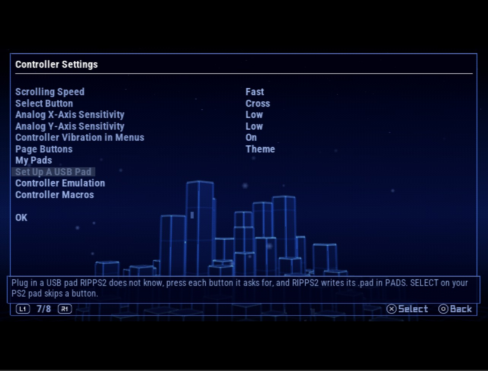
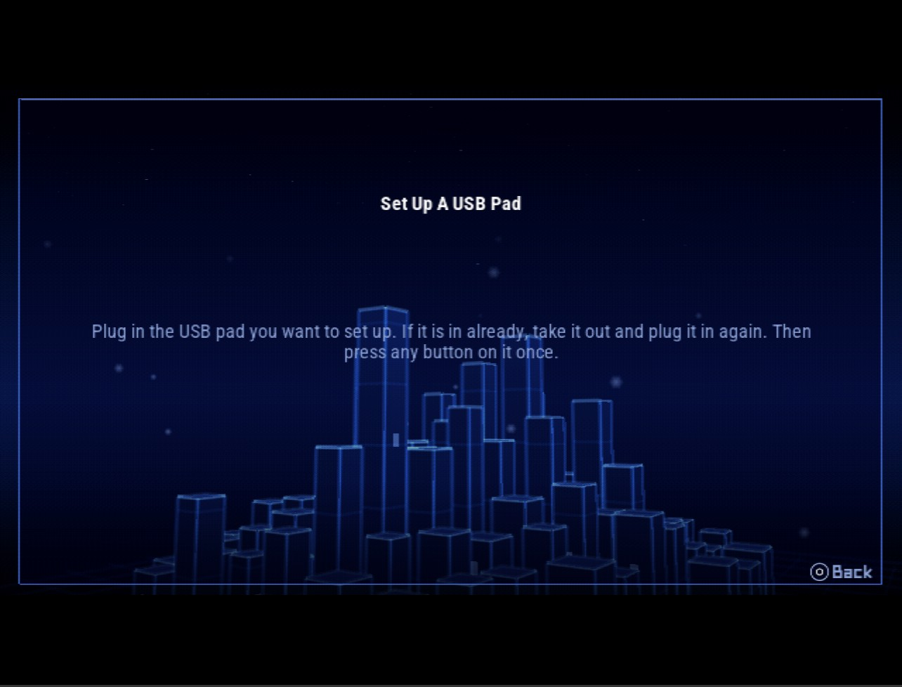

## Rip it: RIPPS2 v1.2.9 beta (build 129)

**[Watch the tour](https://youtu.be/OEa8b5rbyco)** (10:48): everything RIPPS2 does, from the web page it started as to the in-game menu, with chapters.

**[Download RIPPS2.elf](https://github.com/akilluminati47/RIPPS2/releases/download/v1.2.9-beta/RIPPS2.elf)** (one file, 2,743 KB) and put it in place of your old one. Your settings stay where they were. **[RIPPS2-lite.elf](https://github.com/akilluminati47/RIPPS2/releases/download/v1.2.9-beta/RIPPS2-lite.elf)** (2,200 KB) is the same RIPPS2 without the programs it carries for BIBLE (PS2BBL) and Neutrino. **[RIPPS2-languages.zip](https://github.com/akilluminati47/RIPPS2/releases/download/v1.2.9-beta/RIPPS2-languages.zip)** puts RIPPS2 in your language (33 of them, every new line translated). The **[theme pack](https://github.com/akilluminati47/RIPPS2-themes/releases/latest)** stays at edition 128.

### USB pads RIPPS2 did not know
- **Set Up A USB Pad** (Settings > Controllers): plug the pad in, let go, then press each button and push each stick as RIPPS2 asks. SELECT on your PS2 pad skips a button you do not have. Try the result live, and save: RIPPS2 writes the pad's profile as `PADS/VVVV_PPPP.pad` beside itself, checked with the same reader that loads it. It finds buttons, a hat d-pad, analog triggers and sticks, inverted ones too. Set the same pad up again and the old file is kept as `.bak`.
- **A profiled pad steers the menu**, from boot and as soon as you save it.
- **It plays in games** with the Pad Emulator on. As the game starts RIPPS2 checks your profiles (up to four) and hands them to PADEMU in one small block, so nothing is read from a file during the game. The pads PADEMU already knows (DualShock 3 and 4, the ShanWan copy) keep their own drivers.
- **A button map per game**: `PADS/GAMES/<game ID>.pad` with lines like `cross=circle` or `select=none` moves buttons for that game, on every USB pad.
- **My Pads** checks every profile and says what is wrong with any it refuses. The format is plain text, [written up here](https://github.com/akilluminati47/RIPPS2/blob/main/docs/plans/pad-spec.md): send us yours so others with the same pad can use it.

 Controllers: Set Up A USB Pad">

### Please test
Every pad is different, so this one needs your pads: a copy DS3, an 8BitDo, an arcade stick, any USB gamepad. Does Set Up find every button, does the menu move with it, and does it play in a game with the Pad Emulator on? Please [open an issue](https://github.com/akilluminati47/RIPPS2/issues) with the pad's name, the `.pad` RIPPS2 wrote, your console model and a photo of anything odd.

Full list of changes: [CHANGELOG.md](https://github.com/akilluminati47/RIPPS2/blob/main/CHANGELOG.md).
