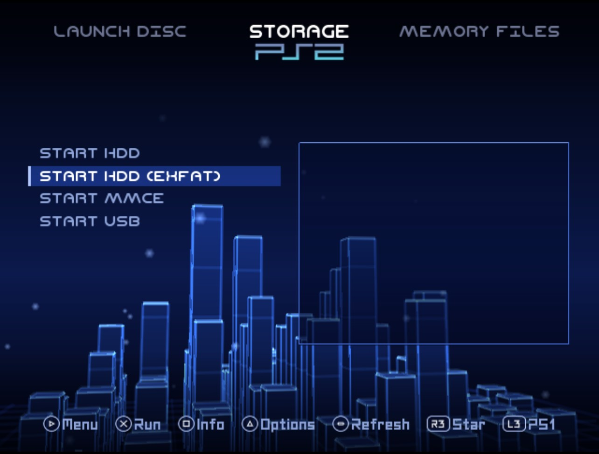
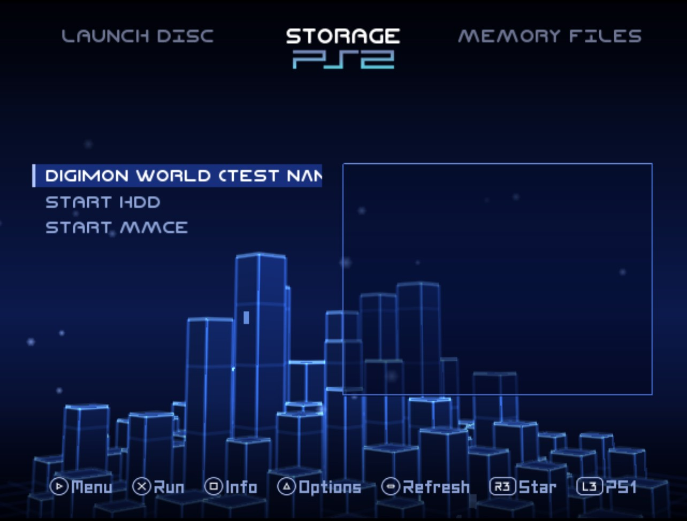

## Rip it: RIPPS2 v1.3.0 beta (build 130)

**[Watch the tour](https://youtu.be/OEa8b5rbyco)** (10:48): everything RIPPS2 does, from the web page it started as to the in-game menu, with chapters.

**[Download RIPPS2.elf](https://github.com/akilluminati47/RIPPS2/releases/download/v1.3.0-beta/RIPPS2.elf)** (one file, 2,747 KB) and put it in place of your old one. Your settings stay where they were. **[RIPPS2-lite.elf](https://github.com/akilluminati47/RIPPS2/releases/download/v1.3.0-beta/RIPPS2-lite.elf)** (2,203 KB) is the same RIPPS2 without the programs it carries for BIBLE (PS2BBL) and Neutrino. **[RIPPS2-languages.zip](https://github.com/akilluminati47/RIPPS2/releases/download/v1.3.0-beta/RIPPS2-languages.zip)** puts RIPPS2 in your language (33 of them, every new line translated). The **[theme pack](https://github.com/akilluminati47/RIPPS2-themes/releases/latest)** stays at edition 128.

### Videos
- **Long videos open.** A two-hour film stopped at "Opening the video": the player kept 12 bytes for every chunk of the file's index, grown a little at a time, and ran out of memory. It now keeps a bit per frame, the key frames and each sound chunk's place, sized once from the file's own counts: 1.6 MB for a 2 h 41 min film. **L1 / R1 skip** through all of it.
- **Every video opens faster**, a short one too, over MMCE most of all: each small read of the index went to the drive as a seek and a 4-byte read. Now they come out of the player's buffer.
- **VIDEO.TXT**: each step of opening a video (the file, its index, the codec, the screen, the sound, the first frame) goes to VIDEO.TXT beside RIPPS2 and to DIAG.TXT, so a video that never starts says where it stopped. A video RIPPS2 cannot play (a camera's MJPEG, say) says so and goes back to the list.

### PS1 games named on their own drive
- POPStarterGameInstaller names a game's files with a code and writes the game's name into `conf_apps.cfg` on the drive it put the game on. RIPPS2 now reads that file from the drive the POPS folder is on (its root, or its OPL folder), on the list and on the info page. Nothing is renamed: art, cheats, VMCs and the launch keep the code.

### START rows
- A drive on Manual with nothing saved for it left All Games (and its own page) blank. Each such drive now has a row after every game: **START HDD**, **START HDD (EXFAT)**, **START USB**, **START MX4SIO**, **START MMCE**, **START NETWORK**. Cross starts the drive and its games take the row's place. A START row is never saved, starred or set up, and the random game never lands on one.

### Memory Files
- **A file copied onto a memory card stays.** It was copied, then failed its read-back check and was removed: a memory card cannot answer the 64-bit seek the check used.
- **A memory card folder lists in one read**, names, folders and sizes together, as uLaunchELF reads it: a 64 MB card full of saves was painfully slow.

### Please test
Play a long film, a short clip and a phone clip from MMCE and from USB, and skip with L1 / R1. If one stops or never starts, please [open an issue](https://github.com/akilluminati47/RIPPS2/issues) with its **VIDEO.TXT**, your console model, the drive and the video's size and length.

Full list of changes: [CHANGELOG.md](https://github.com/akilluminati47/RIPPS2/blob/main/CHANGELOG.md).
