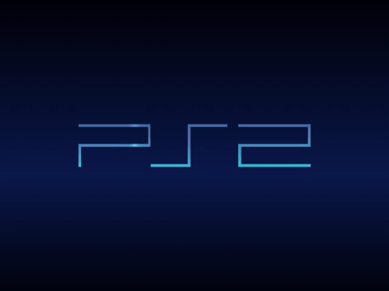
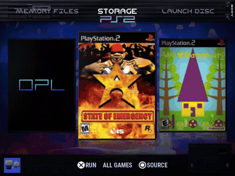
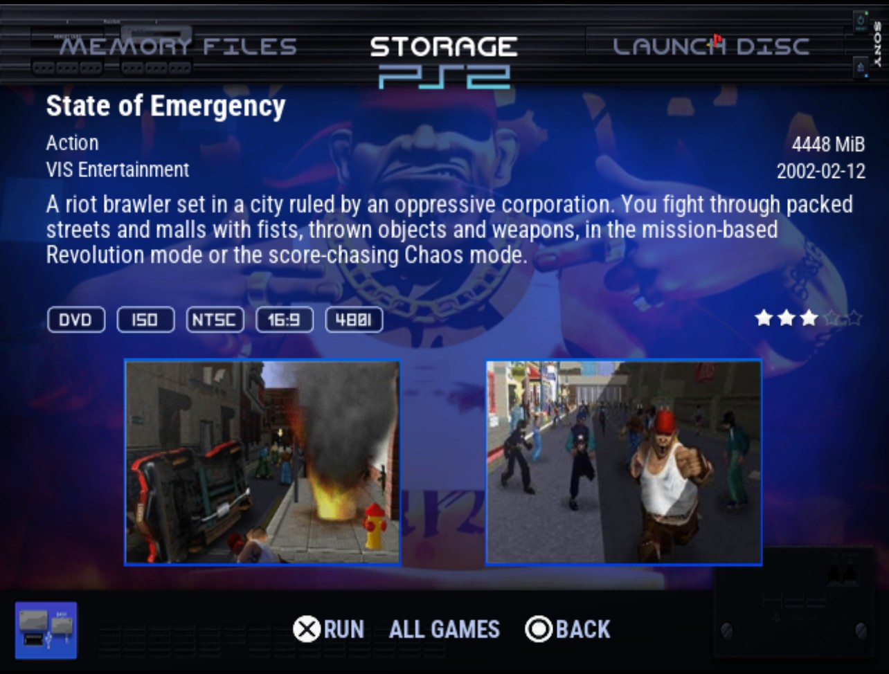
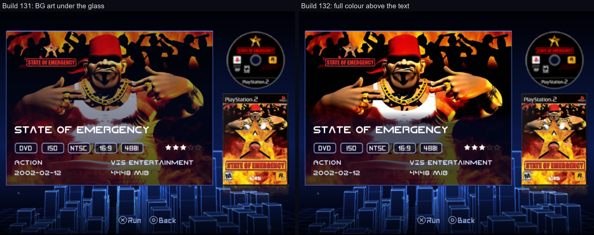
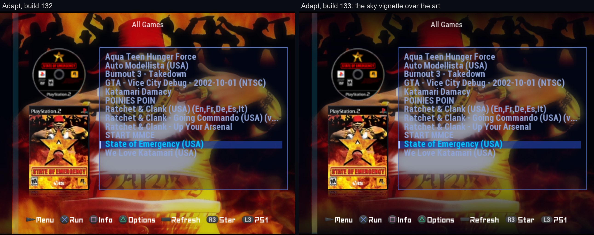
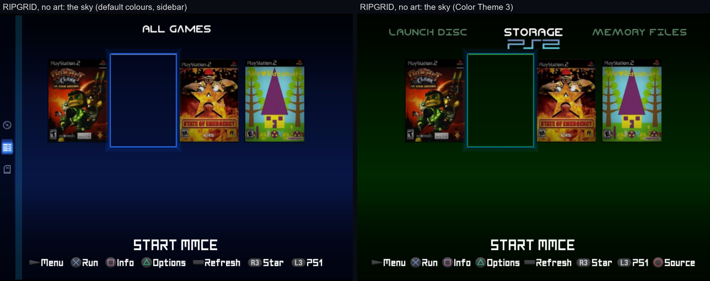
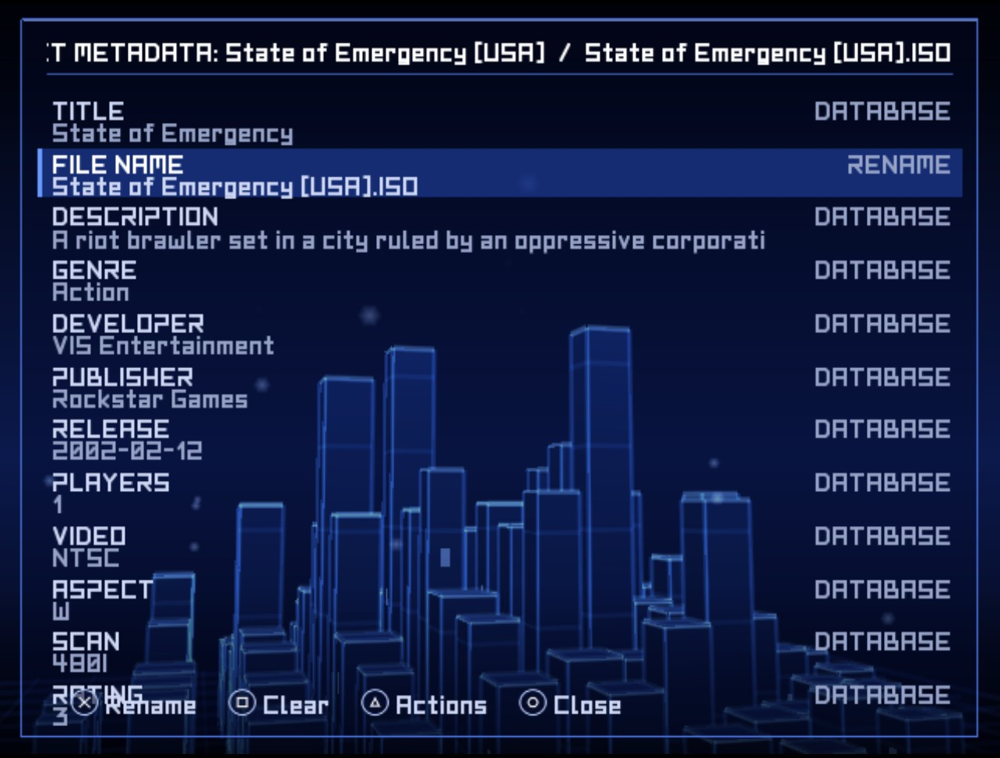
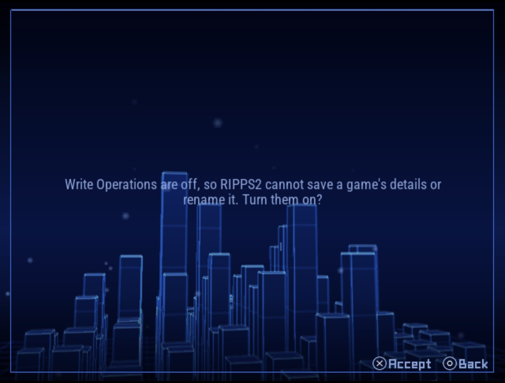
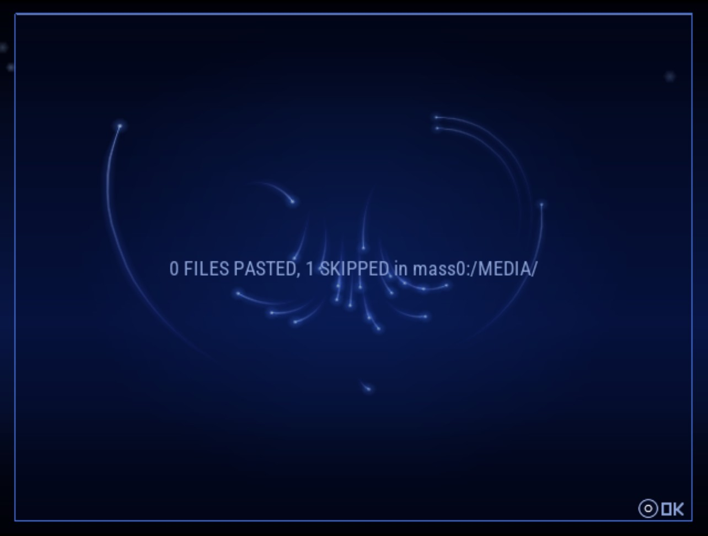

## Rip it: RIPPS2 v1.3.4 beta (builds 131 to 134)

**[Watch the tour](https://youtu.be/OEa8b5rbyco)** (10:48): everything RIPPS2 does, from the web page it started as to the in-game menu, with chapters.

**[Download RIPPS2.elf](https://github.com/akilluminati47/RIPPS2/releases/download/v1.3.4-beta/RIPPS2.elf)** (one file, 2,815 KB) and put it in place of your old one. Your settings stay where they were. **[RIPPS2-lite.elf](https://github.com/akilluminati47/RIPPS2/releases/download/v1.3.4-beta/RIPPS2-lite.elf)** (2,205 KB) is the same RIPPS2 without the programs it carries for BIBLE and Neutrino. **[RIPPS2-languages.zip](https://github.com/akilluminati47/RIPPS2/releases/download/v1.3.4-beta/RIPPS2-languages.zip)** puts RIPPS2 in your language (33 of them, every new line translated). The **[theme pack](https://github.com/akilluminati47/RIPPS2-themes/releases/latest)** stays at edition 128.

### BIBLE, signed for RIPPS2 (build 134)

<a href="https://github.com/akilluminati47/RIPPS2/releases/download/v1.3.4-beta/bible-boot.mp4">BIBLE at power on: its splash, the keys page, the info page, then RIPPS2 (video, 18 s)</a>

- **RIPPS2 now carries BIBLE itself**: our boot loader built on El Isra's PS2BBL, with its splash, keys pages and HD modes, its memory card, MX4SIO and HDD builds signed for RIPPS2. The signed files are also on [BIBLE's release page](https://github.com/akilluminati47/BIBLE/releases).
- **Settings > General > Boot Loader > Manage** installs it on the memory card or the HDD you pick. What started before is kept in a backup folder (hold CIRCLE at power on to start it), and RESTORE puts it back.
- **BOOT LOCK** makes it start RIPPS2 at power on, at once, from wherever RIPPS2 lives. The install writes the config BIBLE reads, `mc?:/SYS-CONF/PS2BBL.INI`.
- **First console binds wanted.** The console binds the file to your card as it installs; no console had done that with these files when this went out. If a console refuses it, RIPPS2 puts the card back as it was. Tell us either way.

### Video (build 131)

<a href="https://github.com/akilluminati47/RIPPS2/releases/download/v1.3.4-beta/video-pause-130-vs-134.mp4">Pause, build 130 (left) and 134 (right): the video with sound, 15 s</a>

<a href="https://github.com/akilluminati47/RIPPS2/releases/download/v1.3.4-beta/video-end-130-vs-134.mp4">The end of a clip, build 130 (left) and 134 (right), with sound</a>

- **A paused video is silent on its held frame**: the sound fades out and stays quiet for the whole pause (it used to repeat a bit of sound), and fades back in with the picture.
- **A video ends cleanly**: no repeated sound after the last bit, and the last frames keep the film's pace (they could stall for seconds). Back, Select and L1 / R1 go quiet the same way.

### RIPFLOW and the info pages (build 132)

<a href="https://github.com/akilluminati47/RIPPS2/releases/download/v1.3.4-beta/ripflow-flank.mp4">RIPFLOW: rest on a game and the hints turn (video)</a>

- **The hints beside the source name turn to Square INFO and Triangle OPTIONS** after 4.2 s on a game, fading on the screenshots' time, and back when you move.
- **RIPFLOW's info page**: LAUNCH DISC / STORAGE / MEMORY FILES stay (as your Category Bar setting says), the title is bigger, and the genre, size, developer and release date sit on two lines over the description, without labels.
- **RIPPS2's info page shows the background art and screenshots in full colour**; the glass shades only the band the text is on.

### Themes (build 133)
- **RIPGRID with the sidebar: L1 / R1 turn the grid's pages**, like L2 / R2.
- **A star on the right sits at the row's right edge**, in a column, and **Adapt, Adapt Rx and themes made for OPL put it there** unless they say otherwise.
- **Adapt and RIPGRID use Storage's sky** where they had a flat colour, in your Color Theme, and a **sky vignette** fades the top and bottom of the game's background art into it.

### Settings and Memory Files (build 134)
- **Set Metadata has the title and the file name filled in**; Cross on FILE NAME renames the game. With Write Operations off it asks to turn them on.
- **A paste in Memory Files says how many and where** in a box you dismiss with OK.
- **General & System opens without a hitch** (it read both memory cards every time).

### Please test
Install BIBLE with Manage on a spare memory card first, and tell us whether your console took it and RIPPS2 starts at power on. Then pause and finish a video, and try the new info pages. Please [open an issue](https://github.com/akilluminati47/RIPPS2/issues) with your console model, the card or HDD and a photo of anything odd.

Full list of changes: [CHANGELOG.md](https://github.com/akilluminati47/RIPPS2/blob/main/CHANGELOG.md).
