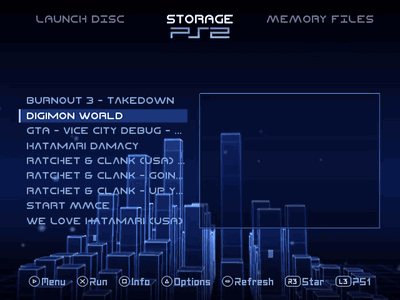
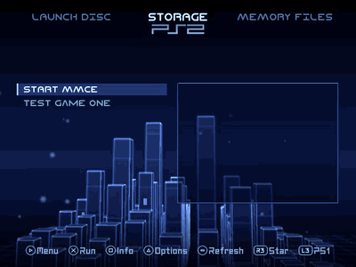
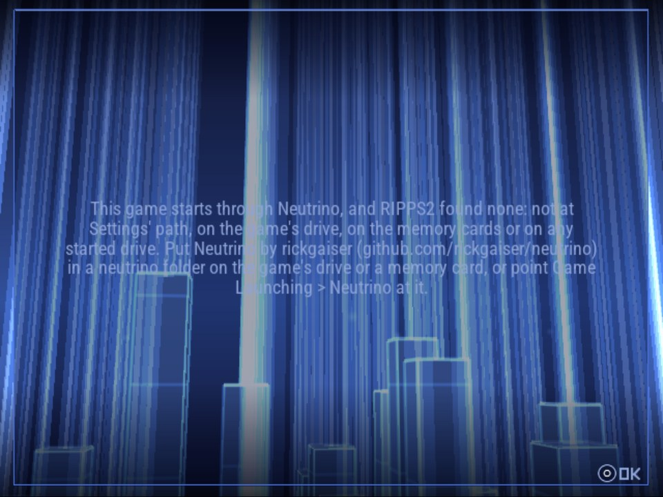
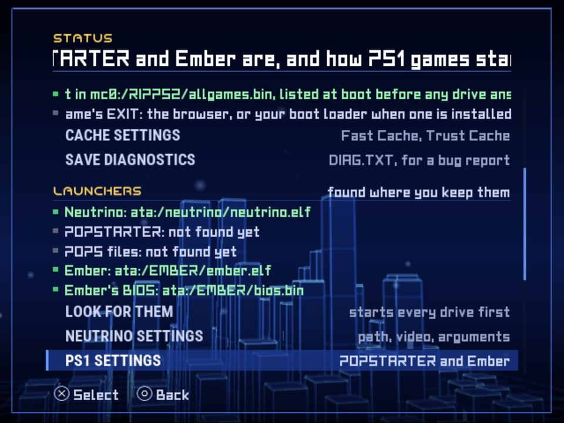
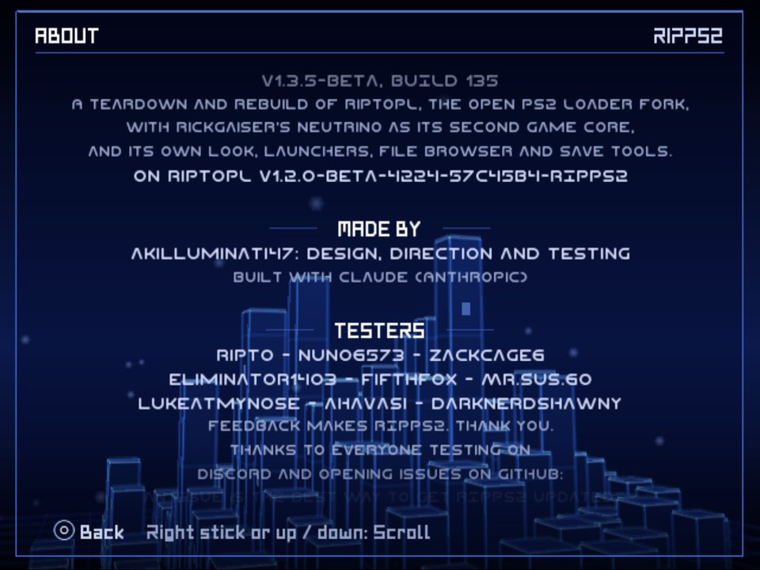

## Rip it: RIPPS2 v1.3.5 beta (build 135)

**[Watch the tour](https://youtu.be/OEa8b5rbyco)** (10:48): everything RIPPS2 does, from the web page it started as to the in-game menu, with chapters.

**[Download RIPPS2.elf](https://github.com/akilluminati47/RIPPS2/releases/download/v1.3.5-beta/RIPPS2.elf)** (one file, 2,580 KB) and put it in place of your old one. Your settings stay where they were. There is one RIPPS2.elf again: the lite ELF is gone, because the full one no longer carries Neutrino. **[RIPPS2-languages.zip](https://github.com/akilluminati47/RIPPS2/releases/download/v1.3.5-beta/RIPPS2-languages.zip)** has RIPPS2 in 33 languages, and the **[theme pack](https://github.com/akilluminati47/RIPPS2-themes/releases/latest)** (edition 128) still fits.

### Neutrino: yours, found where you keep it

<a href="https://github.com/akilluminati47/RIPPS2/releases/download/v1.3.5-beta/neutrino-found.mp4">A PS2 game starting through the Neutrino in the drive's neutrino folder (video, 13 s)</a>

- **RIPPS2 no longer carries Neutrino.** It uses yours, from where it always looked: the path in Game Launching > Neutrino, a `neutrino` folder on the game's drive or a memory card, or wherever STATUS > LOOK FOR THEM or an earlier launch found one. Get it from [rickgaiser's Neutrino](https://github.com/rickgaiser/neutrino/releases).
- **A Neutrino game with none anywhere says where to get it and where to put it**, after offering to search the drives, instead of offering to install a copy. The game then starts on the OPL core, as before.
- **STATUS** still shows where Neutrino was found under LAUNCHERS; its INSTALL RIPPS2'S NEUTRINO row is gone, and NEUTRINO SETTINGS says where to get it. rickgaiser's Neutrino and ORBIT's fork stay in About's credits.

<a href="https://github.com/akilluminati47/RIPPS2/releases/download/v1.3.5-beta/neutrino-none.mp4">No Neutrino anywhere: the search offer, declined, then where to put it (video, 15 s)</a>

### One RIPPS2.elf, with BIBLE inside
- **RIPPS2-lite.elf is gone.** With Neutrino no longer inside, the one RIPPS2.elf (2,580 KB, 235 KB smaller than 1.3.4's) carries only BIBLE, for Settings > General > Boot Loader > Manage. If you used the lite ELF, put RIPPS2.elf in its place.
- **BIBLE's first console binds are still wanted.** Install it with Manage on a spare memory card first; if your console refuses it, RIPPS2 puts the card back as it was.

### Languages
- The changed lines are in all 32 languages, and so is this README.

### Please test
Start a Neutrino game with your Neutrino on the game's drive, on a memory card, and at a path you set, and once with none at all. Please [open an issue](https://github.com/akilluminati47/RIPPS2/issues) with your console model, where your Neutrino is and your `DIAG.TXT` (STATUS > SAVE DIAGNOSTICS).

Full list of changes: [CHANGELOG.md](https://github.com/akilluminati47/RIPPS2/blob/main/CHANGELOG.md).
