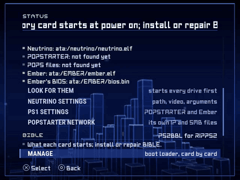
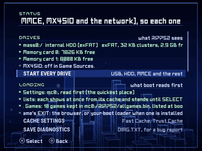
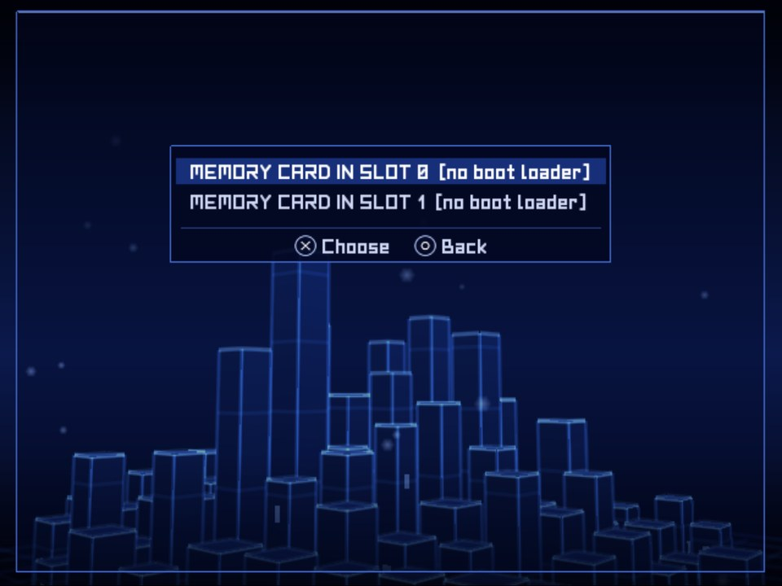
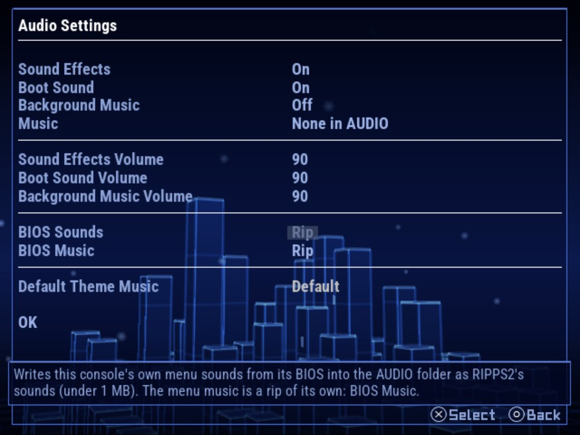
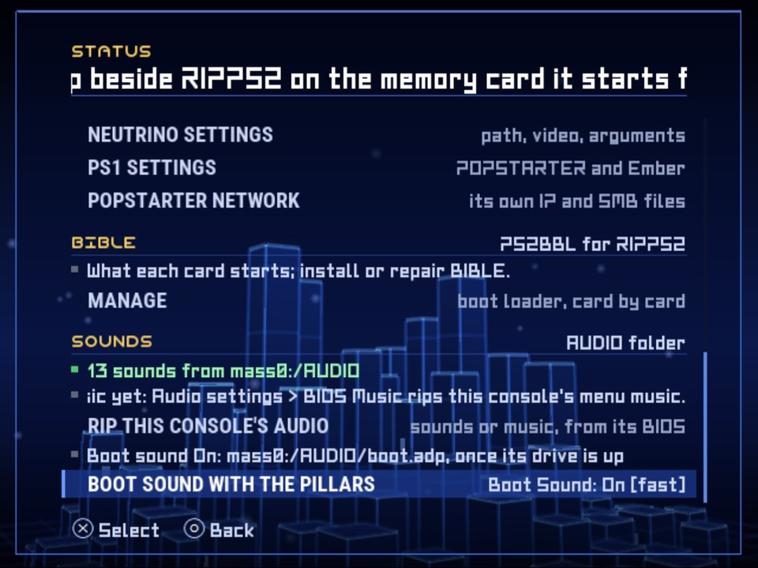
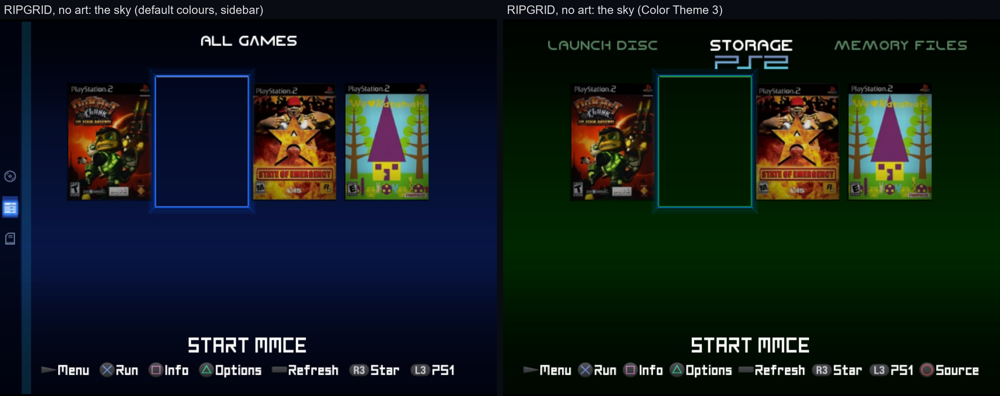

## Rip it: RIPPS2 v1.3.6 beta (build 136)

**[Watch the tour](https://youtu.be/OEa8b5rbyco)** (10:48): everything RIPPS2 does, from the web page it started as to the in-game menu, with chapters.

**[Download RIPPS2.elf](https://github.com/akilluminati47/RIPPS2/releases/download/v1.3.6-beta/RIPPS2.elf)** (one file, 2,723 KB) and put it in place of your old one. Your settings stay where they were. **[RIPPS2-languages.zip](https://github.com/akilluminati47/RIPPS2/releases/download/v1.3.6-beta/RIPPS2-languages.zip)** has RIPPS2 in 33 languages, and the **[theme pack](https://github.com/akilluminati47/RIPPS2-themes/releases/latest)** is at edition 136.

### BIBLE: the MMCE build, and no bind on an SD2PSX

<a href="https://github.com/akilluminati47/RIPPS2/blob/v1.3.6-beta/media/b136/bible-manage.mp4">BIBLE's Manage: the cards by slot, then the picker (video, 14 s)</a>

- **BIBLE's MMCE build is carried too, signed by akilluminati47.** It reads `mmce0:/` and `mmce1:/`, so with RIPPS2 on an SD2PSX or MemCard PRO 2, Manage installs it on a genuine memory card in the other slot and it starts RIPPS2 from the SD card at power on. Put that genuine card in slot 0: the console boots slot 0's card first.
- **On an SD2PSX or MMCE card, Manage warns first.** One SD2PSX refused the bind in testing and then stopped answering until a power cycle. Build 136 stopped there; **[build 137](https://github.com/akilluminati47/RIPPS2/blob/main/CHANGELOG.md) binds BIBLE to an SD2PSX or MMCE BOOT card on START** (its firmware answers the bind's key step) and logs each step to DIAG.TXT.
- **A refused bind on any card** now says to turn the console off and on if the card has gone.
- **Slots are counted 0 and 1**, as mc0: and mc1: and Memory Files name them: every Manage and BOOT LOCK message, STATUS's card lines and the game VMC slots.

### STATUS: your console's audio

<a href="https://github.com/akilluminati47/RIPPS2/blob/v1.3.6-beta/media/b136/status-audio.mp4">STATUS to Audio Settings and back (video, 16 s)</a>

- **RIP THIS CONSOLE'S AUDIO** opens Audio Settings on BIOS Sounds, with BIOS Music right below it: pick sounds or music there.
- **The boot sound line names its file**, and says when it is on a memory card (read as the pillars rise), an AUDIO folder kept on a card included.

### RIPGRID and Adapt: the source name
- **With the categories across the top it is Pop In only**: the big name as the source changes, and nothing in the category row (RIPGRID drew the name over STORAGE when Source Name was Shown).
- **With the sidebar it shows over the grid too**, in Planet N on RIPGRID; Adapt and Adapt Rx (theme pack edition 136) follow the same rule in their own face.
- A Source Name set to Shown in Settings now sits under the PS2 mark instead of over the labels.

### Languages
- Every new and changed line is in all 32 languages, and so is this README.

### Please test
On an SD2PSX or MemCard PRO 2: open Manage and pick its slot (it should explain and offer BOOT LOCK), then install BIBLE on a genuine card in the other slot and power on with it in slot 0. Please [open an issue](https://github.com/akilluminati47/RIPPS2/issues) with your console model, your cards and your `DIAG.TXT` (STATUS > SAVE DIAGNOSTICS).

Full list of changes: [CHANGELOG.md](https://github.com/akilluminati47/RIPPS2/blob/main/CHANGELOG.md).
