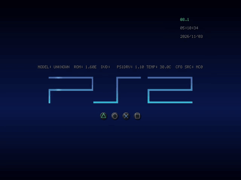
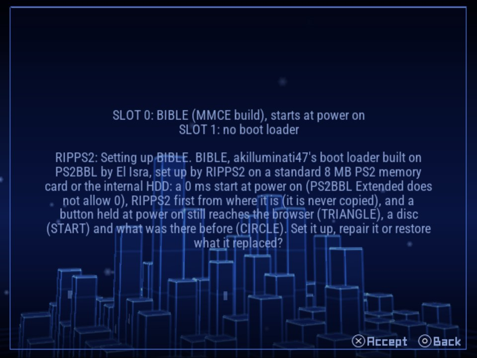
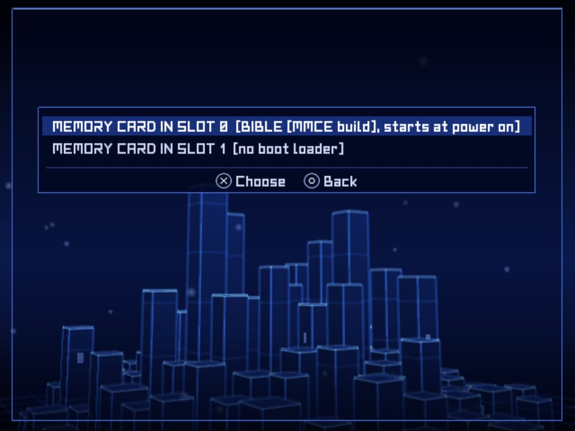
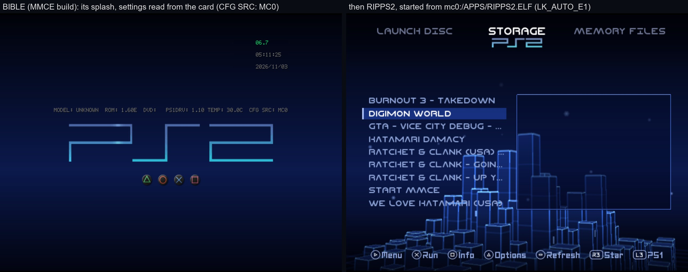

## Rip it: RIPPS2 v1.3.8 beta (build 138)

**[Watch the tour](https://youtu.be/OEa8b5rbyco)** (10:48): everything RIPPS2 does, from the web page it started as to the in-game menu, with chapters.

**[Download RIPPS2.elf](https://github.com/akilluminati47/RIPPS2/releases/download/v1.3.8-beta/RIPPS2.elf)** (one file, 2,730 KB) and put it in place of your old one. Your settings stay where they were. **[RIPPS2-languages.zip](https://github.com/akilluminati47/RIPPS2/releases/download/v1.3.8-beta/RIPPS2-languages.zip)** has RIPPS2 in 33 languages, and the **[theme pack](https://github.com/akilluminati47/RIPPS2-themes/releases/latest)** stays at edition 136.

### BIBLE boots on a real PS2

**BIBLE** is akilluminati47's boot loader, built on [PS2BBL](https://github.com/israpps/PlayStation2-Basic-BootLoader) by El Isra and [PS2BBL Extended](https://github.com/saildot4k/PlayStation2-Basic-BootLoader-Extended) by saildot4k (GPL-3), with its own splash, keys pages and HD modes. Every BIBLE build in this release was **signed by akilluminati47**, with kelftool on their own PC; no one else's keys or signing were used.

**BIBLE rides inside RIPPS2.elf: there is nothing else to download.** RIPPS2 carries all four signed builds (memory card, MMCE, MX4SIO and the HDD's), and **Settings > General > Boot Loader > Manage** installs the one that fits where RIPPS2 lives. [BIBLE's release page](https://github.com/akilluminati47/BIBLE/releases/latest) has the same files for other installers, and a ready SD2PSX BOOT card.

#### What was tested on a real PS2
| What | Where | Result |
|---|---|---|
| Signing all four BIBLE builds | akilluminati47's PC, kelftool (memory card builds: dnasload, HDD build: fhdb) | Signed by akilluminati47 on 11/02 and 11/03 |
| Binding BIBLE's MMCE build with KELFBinder | SCPH-39001 (USA, fat), SD2PSX BOOT card in slot 0 | Bound; at power on BIBLE's splash, then RIPPS2 from the SD card |
| **Binding it with RIPPS2's own Manage** (build 138) | the same PS2 and SD2PSX | **Bound**; at power on BIBLE, then RIPPS2 |
| Manage telling what the card holds | the same | "BIBLE (MMCE build), starts at power on" |
| The premade SD2PSX BOOT card (BIBLE's release page) | the same | BIBLE's splash, then RIPPS2 |
| BIBLE's MX4SIO build | PCSX2 only | Reaches its splash; not yet on a PS2 |
| BIBLE's memory card and HDD builds | not changed since 1.3.4 | Not yet bound on a PS2 |

#### What changed (build 138)
- **BIBLE's MMCE and MX4SIO builds start.** The ones 1.3.4 to 1.3.6 carried stopped on a black screen at power on: their own memory card driver did not load on the console, so they waited for it forever. BIBLE [`a1ffb0b`](https://github.com/akilluminati47/BIBLE/commit/a1ffb0b) loads RIPPS2's memory card and pad drivers instead, and akilluminati47 signed both again.
- **Manage binds the way KELFBinder does.** The console binds BIBLE to your card through a security module the I/O processor boots for it. RIPPS2 now boots **KELFBinder's own IOPRP image**, byte for byte (by El Isra, GPL-3, carried as data in RIPPS2.elf, see [`elf/kelfbinder`](https://github.com/akilluminati47/RIPPS2/tree/main/elf/kelfbinder)), with only the memory card and pad drivers loaded. With the module RIPPS2 used before, the SD2PSX would not log in and the bind was refused; with this one it binds. DIAG.TXT says how the card logged in and each try.
- **BIBLE is recognized by its own bytes.** A bind changes only 32 bytes of the file, so Manage, BOOT LOCK and STATUS compare the rest with the builds RIPPS2 carries and say "BIBLE (MMCE build)" and so on, whatever the folder's icon says (a KELFBinder install showed as PS2BBL).
- **Manage names BIBLE** as akilluminati47's boot loader built on PS2BBL by El Isra, in all 32 languages, and so does the config it writes.
- From 1.3.7: Manage binds an SD2PSX or MMCE BOOT card on START after a warning, and Slots are counted 0 and 1 everywhere.

#### BIBLE's settings file
BIBLE reads **`mc?:/SYS-CONF/PS2BBL.INI`** on the card it starts from (else `PS2BBL/CONFIG.INI` on a card, USB, MMCE or the HDD). Manage writes it for you, starting RIPPS2 from where it is, at once, with BOOT LOCK on; open it in RIPPS2's **Memory Files** (MEMORY CARD 0 > SYS-CONF) to change it. Lines starting with `#` are notes, and every key is optional.

| Key | What it does |
|---|---|
| `KEY_READ_WAIT_TIME` | How long (ms) a button held at power on can pick its entry instead of AUTO |
| `LOGO_DISPLAY` | 0 nothing on screen, 2 BIBLE's splash, 3 the splash with each button's name |
| `BIBLE_GLYPHS` | The buttons under the logo: 0 none, 1 the face buttons, 2 all sixteen |
| `BIBLE_INFO` | 1: console model, clock and countdown on the splash |
| `VIDEO_MODE` | AUTO, NTSC, PAL, 480P, 576P, 720P or 1080I |
| `BIBLE_WIDESCREEN` | AUTO (RIPPS2's Widescreen, else the PS2's 16:9 setting), ON or OFF |
| `BIBLE_COLOR` | The sky: top, horizon and floor colours (`0D0000,700400,170000`); unset, the Color Theme RIPPS2 saved |
| `NAME_<button>`, `LK_<button>_E1` to `_E3` | What each button starts (AUTO: no button held), the first entry that exists; `$OSDSYS` the browser, `$CDVD` the disc, `$CREDITS` BIBLE's credits |

At power on, **L2 + R2** shows every button's launch path and **TRIANGLE + CROSS** opens the video mode page.

### Please test
Install BIBLE with Manage on a **genuine memory card**, an **SD2PSX** or a **MemCard PRO 2**, and power on with it; PAL and Japanese consoles are wanted most. Please [open an issue](https://github.com/akilluminati47/RIPPS2/issues) with your console model, your card, a photo of anything odd and your `DIAG.TXT` (STATUS > SAVE DIAGNOSTICS).

Thanks to **El Isra** for PS2BBL and KELFBinder, and to **saildot4k** for PS2BBL Extended.

Full list of changes: [CHANGELOG.md](https://github.com/akilluminati47/RIPPS2/blob/main/CHANGELOG.md).
