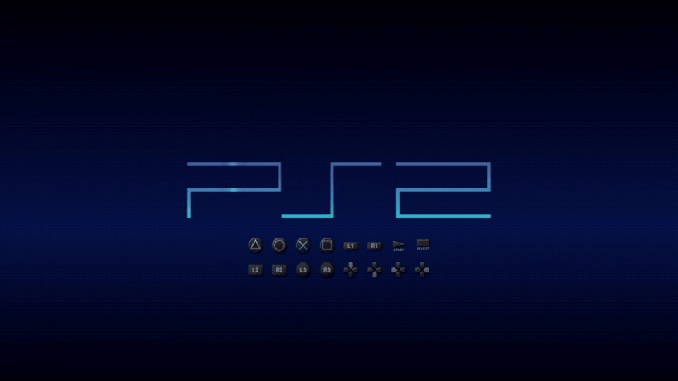
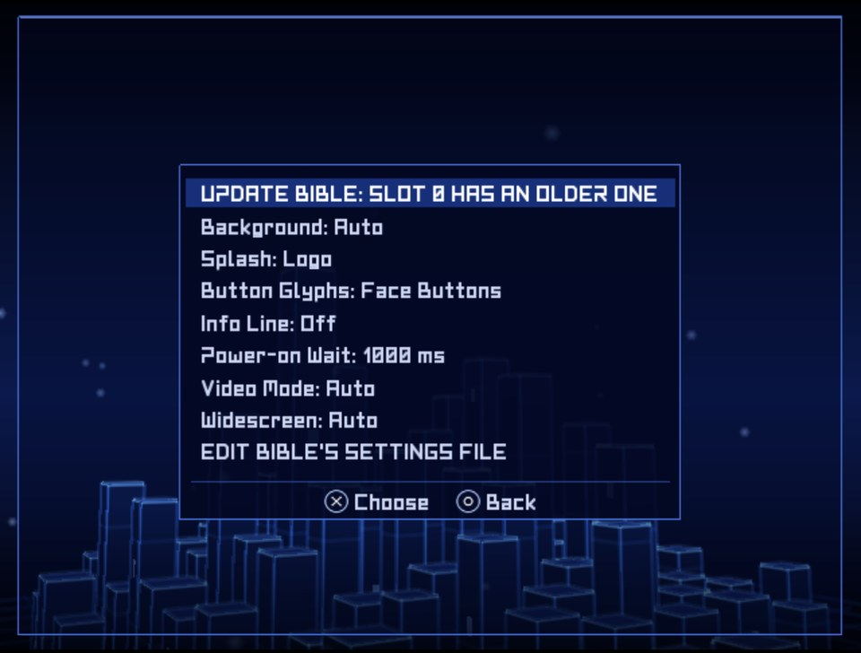
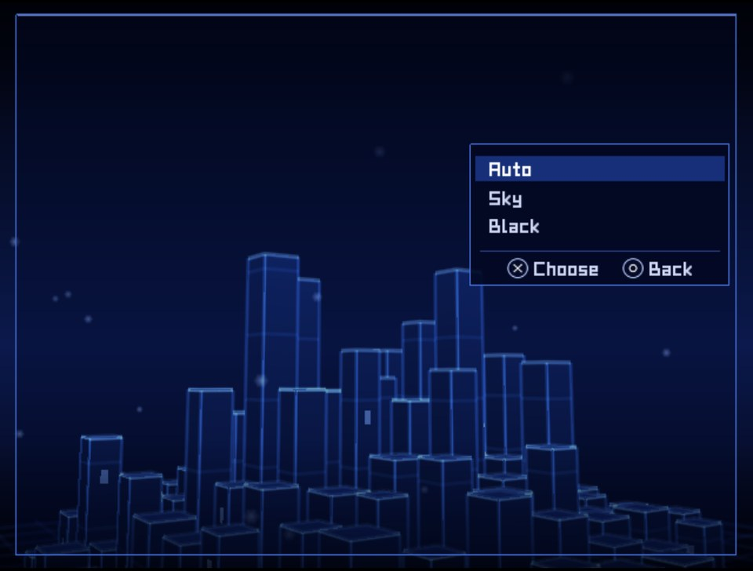
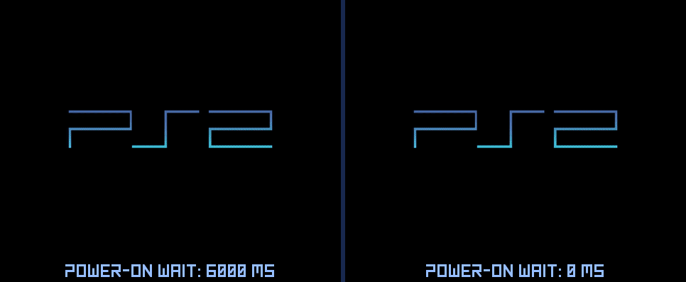
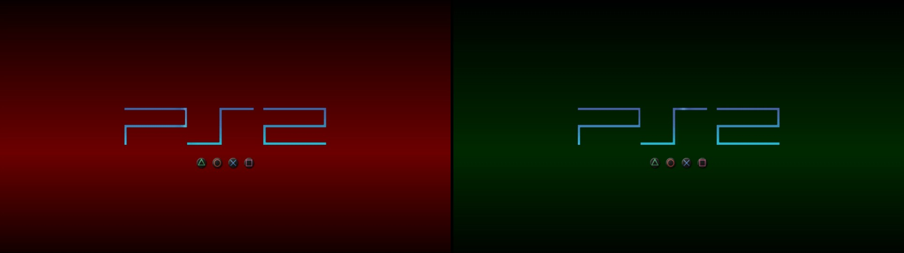

## Rip it: RIPPS2 v1.3.9 beta (build 139)

**[Watch the tour](https://youtu.be/OEa8b5rbyco)** (10:48): everything RIPPS2 does, from the web page it started as to the in-game menu, with chapters.

**[Download RIPPS2.elf](https://github.com/akilluminati47/RIPPS2/releases/download/v1.3.9-beta/RIPPS2.elf)** (one file, 2,764 KB) and put it in place of your old one. Your settings stay where they were. **[RIPPS2-languages.zip](https://github.com/akilluminati47/RIPPS2/releases/download/v1.3.9-beta/RIPPS2-languages.zip)** has RIPPS2 in 33 languages, and the **[theme pack](https://github.com/akilluminati47/RIPPS2-themes/releases/latest)** stays at edition 136.

### BIBLE, set up from RIPPS2

**BIBLE** is akilluminati47's boot loader, built on [PS2BBL](https://github.com/israpps/PlayStation2-Basic-BootLoader) by El Isra and [PS2BBL Extended](https://github.com/saildot4k/PlayStation2-Basic-BootLoader-Extended) by saildot4k (GPL-3). RIPPS2 1.3.9 carries **BIBLE's next update**, all four builds **signed by akilluminati47**, and no longer needs anything else to install it, update it or change it: **Settings > General > Boot Loader > Manage** does all of it.

**Nothing else to download.** BIBLE rides inside RIPPS2.elf. [BIBLE's release page](https://github.com/akilluminati47/BIBLE/releases/latest) has the same signed files for other installers.

#### Manage's BIBLE menu
With BIBLE on a card, Manage opens a menu of its own:

- **UPDATE BIBLE** (or **SET UP, UPDATE OR RESTORE BIBLE**): binds the BIBLE this RIPPS2 carries to your card, over the older one, in place. RIPPS2 1.3.9 recognizes every BIBLE it carried before (1.3.4 to 1.3.8) and says "BIBLE (MMCE build, older)".
- **Background**: **Auto** (your RIPPS2 sky when BIBLE starts RIPPS2, black for anything else), **Sky** or **Black**.
- **Splash** (off, the logo, the logo with button names), **Button Glyphs** (none, the four face buttons, all sixteen), **Info Line** (console model, clock and countdown), **Power-on Wait**, **Video Mode** (up to 1080i) and **Widescreen**.
- **EDIT BIBLE'S SETTINGS FILE** opens `mc?:/SYS-CONF/PS2BBL.INI` for everything else (what each button starts).

Each choice changes only its own line in BIBLE's settings file; your notes and other lines stay.

Background Black, no buttons, video mode AUTO. PCSX2, RIPPS2 on a memory card; the same 6.5 s of black load is cut from both sides, so the 6 s between them is real. The 0 ms side also has <code>DISC_STOP = 0</code> in BIBLE's settings file: BIBLE then leaves the disc drive alone at launch instead of waiting for it, 3.3 s saved here.

Background Auto: your RIPPS2 Color Theme's sky when BIBLE starts RIPPS2. Here Blood and Ectoplasm, in 1080i.

#### The boot sound, on the card
**Audio settings > Boot Sound > On (fast)** now keeps `boot.adp` beside BIBLE's settings (`mc?:/SYS-CONF/boot.adp`). It is read before any drive starts. BIBLE can also hand it to RIPPS2 in memory, but that has only passed in the lab: on a real SD2PSX, RIPPS2 read the card's copy itself. Boot Sound Off is still the fastest boot.

#### What was tested
| What | Where | Result |
|---|---|---|
| Signing all four BIBLE builds | akilluminati47's PC, kelftool | Signed by akilluminati47 on 11/03 |
| Manage's BIBLE menu on a card with the BIBLE 1.3.8 carried | PCSX2 lab, a card holding akilluminati47's own SD2PSX-bound BIBLE from 1.3.8 | It says UPDATE BIBLE: SLOT 0 HAS AN OLDER ONE; Background: Black wrote one line, `BIBLE_BACKGROUND = BLANK`, and kept the rest |
| BIBLE's Background (Auto, Sky, Black) | PCSX2 lab, BIBLE's own takes | Sky from RIPPS2's settings, black for another AUTO, BLANK forced |
| The boot sound handed over: BIBLE's MMCE build starting RIPPS2 1.3.9 | PCSX2 lab | BIBLE read boot.adp in 440 ms; RIPPS2 took it from memory (DIAG.TXT: "BIBLE handed the boot sound over in RAM"), reached its menu, and STATUS said "handed over by BIBLE" |
| **Updating BIBLE with Manage** (UPDATE BIBLE, over the BIBLE 1.3.8 had bound) | SCPH-39001 (USA, fat), SD2PSX BOOT card in slot 0 | **Bound**; at power on BIBLE 3282396's splash, then RIPPS2 |
| The boot sound on that console | SCPH-39001 (USA, fat), SD2PSX BOOT card in slot 0 | Not handed over: `DIAG.TXT` says "no boot sound handed over" and RIPPS2 read the card's copy itself; the sound still plays |

#### Also in 1.3.9
- **About** credits KELFBinder's IOPRP image (El Isra, GPL-3), which binds BIBLE, and says every BIBLE build is signed by akilluminati47.
- 21 new strings, in all 32 languages.

### Please test
Update BIBLE with Manage on a **genuine memory card**, an **SD2PSX** or a **MemCard PRO 2**, try Background and the boot sound, and power on; PAL and Japanese consoles are wanted most. Please [open an issue](https://github.com/akilluminati47/RIPPS2/issues) with your console model, your card, a photo of anything odd and your `DIAG.TXT` (STATUS > SAVE DIAGNOSTICS).

Thanks to **El Isra** for PS2BBL and KELFBinder, and to **saildot4k** for PS2BBL Extended.

Full list of changes: [CHANGELOG.md](https://github.com/akilluminati47/RIPPS2/blob/main/CHANGELOG.md).
