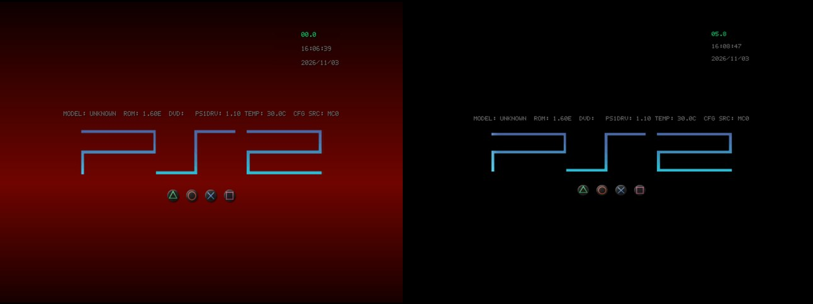

## Rip it: RIPPS2 v1.3.9 beta (build 139)

**[Watch the tour](https://youtu.be/OEa8b5rbyco)** (10:48): everything RIPPS2 does, from the web page it started as to the in-game menu, with chapters.

**[Download RIPPS2.elf](https://github.com/akilluminati47/RIPPS2/releases/download/v1.3.9-beta/RIPPS2.elf)** (one file, 2,764 KB) and put it in place of your old one. Your settings stay where they were. **[RIPPS2-languages.zip](https://github.com/akilluminati47/RIPPS2/releases/download/v1.3.9-beta/RIPPS2-languages.zip)** has RIPPS2 in 33 languages, and the **[theme pack](https://github.com/akilluminati47/RIPPS2-themes/releases/latest)** stays at edition 136.

### BIBLE, set up from RIPPS2

**BIBLE** is akilluminati47's boot loader, built on [PS2BBL](https://github.com/israpps/PlayStation2-Basic-BootLoader) by El Isra and [PS2BBL Extended](https://github.com/saildot4k/PlayStation2-Basic-BootLoader-Extended) by saildot4k (GPL-3). RIPPS2 1.3.9 carries **BIBLE's next update**, all four builds **signed by akilluminati47**, and no longer needs anything else to install it, update it or change it: **Settings > General > Boot Loader > Manage** does all of it.

**Nothing else to download.** BIBLE rides inside RIPPS2.elf. [BIBLE's release page](https://github.com/akilluminati47/BIBLE/releases/latest) has the same signed files for other installers.

#### Manage's BIBLE menu
With BIBLE on a card, Manage opens a menu of its own:

- **UPDATE BIBLE** (or **SET UP, UPDATE OR RESTORE BIBLE**): binds the BIBLE this RIPPS2 carries to your card, over the older one, in place. RIPPS2 1.3.9 recognizes every BIBLE it carried before (1.3.4 to 1.3.8) and says "BIBLE (MMCE build, older)".
- **Background**: **Auto** (your RIPPS2 sky when BIBLE starts RIPPS2, black for anything else), **Sky** or **Black**.
- **Splash** (off, the logo, the logo with button names), **Button Glyphs** (none, the four face buttons, all sixteen), **Info Line** (console model, clock and countdown), **Power-on Wait**, **Video Mode** (up to 1080i) and **Widescreen**.
- **EDIT BIBLE'S SETTINGS FILE** opens `mc?:/SYS-CONF/PS2BBL.INI` for everything else (what each button starts).

Each choice changes only its own line in BIBLE's settings file; your notes and other lines stay.

#### The boot sound, with RIPPS2's first frame
**Audio settings > Boot Sound > On (fast)** now keeps `boot.adp` beside BIBLE's settings (`mc?:/SYS-CONF/boot.adp`). BIBLE reads it while its splash counts down and hands it to RIPPS2 in memory, so the sound plays with RIPPS2's first frame even when RIPPS2 starts from an SD2PSX. STATUS says "handed over by BIBLE". Boot Sound Off is still the fastest boot: with BIBLE's Power-on Wait at 0 ms, BIBLE reads the sound before RIPPS2 starts (about 2 s on a memory card).

#### What was tested
| What | Where | Result |
|---|---|---|
| Signing all four BIBLE builds | akilluminati47's PC, kelftool | Signed by akilluminati47 on 11/03 |
| Manage's BIBLE menu on a card with the BIBLE 1.3.8 carried | PCSX2 lab, a card holding akilluminati47's own SD2PSX-bound BIBLE from 1.3.8 | It says UPDATE BIBLE: SLOT 0 HAS AN OLDER ONE; Background: Black wrote one line, `BIBLE_BACKGROUND = BLANK`, and kept the rest |
| BIBLE's Background (Auto, Sky, Black) and the boot sound hand-off | PCSX2 lab, BIBLE's own takes | Sky from RIPPS2's settings, black otherwise; the sound arrives in RIPPS2 intact |
| Updating BIBLE with Manage and powering on | SCPH-39001 (USA, fat), SD2PSX BOOT card | TEST_HW |

#### Also in 1.3.9
- **About** credits KELFBinder's IOPRP image (El Isra, GPL-3), which binds BIBLE, and says every BIBLE build is signed by akilluminati47.
- 21 new strings, in all 32 languages.

### Please test
Update BIBLE with Manage on a **genuine memory card**, an **SD2PSX** or a **MemCard PRO 2**, try Background and the boot sound, and power on; PAL and Japanese consoles are wanted most. Please [open an issue](https://github.com/akilluminati47/RIPPS2/issues) with your console model, your card, a photo of anything odd and your `DIAG.TXT` (STATUS > SAVE DIAGNOSTICS).

Thanks to **El Isra** for PS2BBL and KELFBinder, and to **saildot4k** for PS2BBL Extended.

Full list of changes: [CHANGELOG.md](https://github.com/akilluminati47/RIPPS2/blob/main/CHANGELOG.md).
