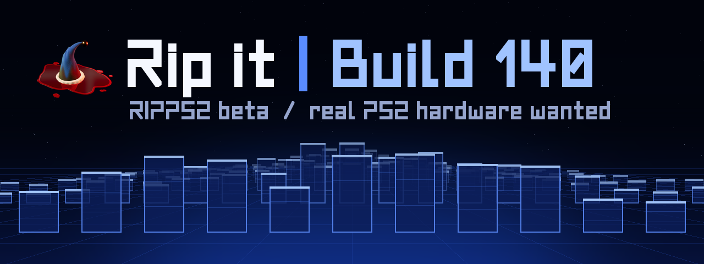
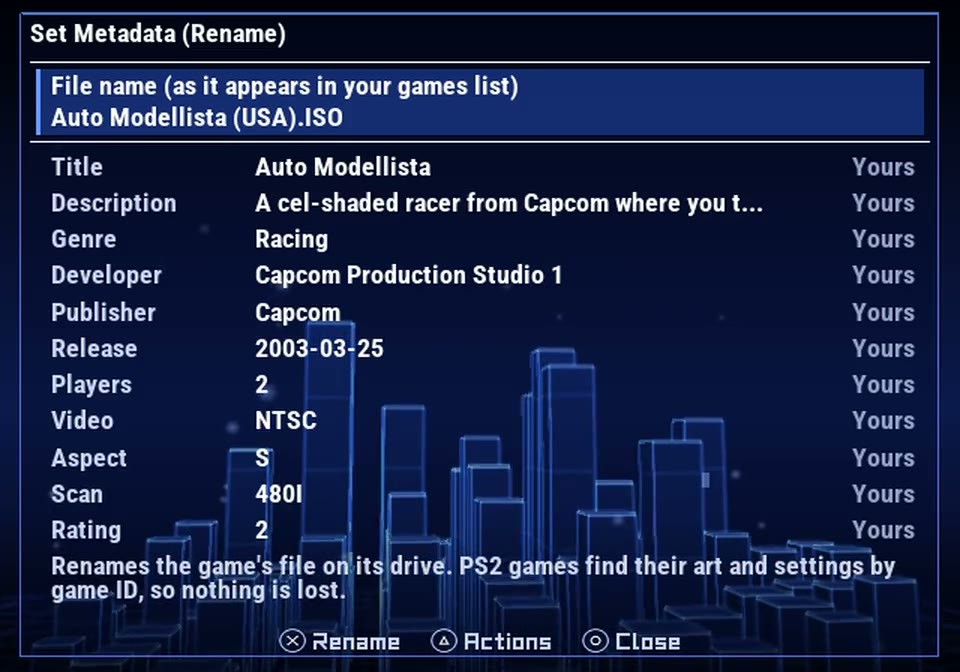
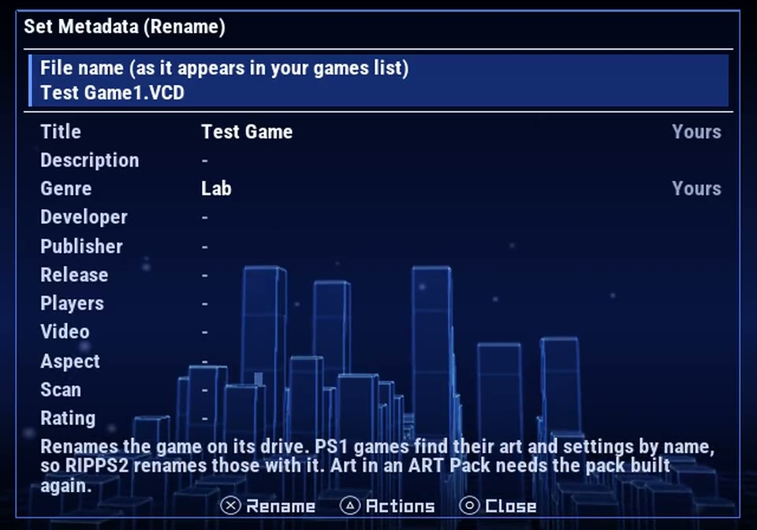
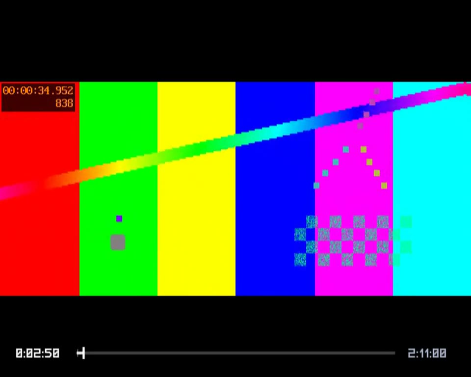
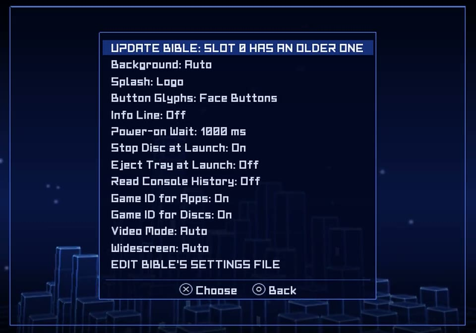

## Rip it: RIPPS2 v1.4.0 beta (build 140)

**[Download RIPPS2.elf](https://github.com/akilluminati47/RIPPS2/releases/download/v1.4.0-beta/RIPPS2.elf)** (one file, 2,768 KB) and put it in place of your old one. Your settings stay where they were. **[RIPPS2-languages.zip](https://github.com/akilluminati47/RIPPS2/releases/download/v1.4.0-beta/RIPPS2-languages.zip)** has RIPPS2 in 33 languages, and the **[theme pack](https://github.com/akilluminati47/RIPPS2-themes/releases/latest)** stays at edition 136.

The pictures below open short silent videos from this repo.

### The sounds, sorted out
- **Stray sounds.** Every ripped sound marked its end in a way that can send a voice on to read other memory, which fits another effect playing after one had finished. Each sound now ends on its own silent block as it loads, and none has been heard since on the test console. Your files are not touched, and there is nothing to rip again.
- **The boot sound comes in with the towers.** It used to wait behind whatever drive job was running. On a SCPH-39001 with an SD2PSX it now plays 0.26 s after the towers, down from 4.46 s.
- **The other sounds are ready at once.** They load ahead of the drive jobs: 5.12 s on that console with every drive on Auto, down from 42.85 s. If your AUDIO folder is on a drive that takes a while to start, they still wait for that drive, and the boot sound now plays through instead of being cut off.
- **Drives coming up during the boot stay quiet.** The connect sound used to play with nothing pressed, right over a cursor move.
- **The music**: a start over another start now goes no further, and `DIAG.TXT` says who asked for each one. If you hear it load twice, your log will show why.

### Set Metadata (Rename)

<a href="https://github.com/akilluminati47/RIPPS2/blob/main/media/b140/set-metadata.mp4">Watch: the new page</a>

- **One name on every row**: PS2 games, PS1 games and apps all read **Set Metadata (Rename)**.
- **A page like Settings**: Roboto, a title with its line, and every field on one screen. Nothing sits under the hints.
- **The file name comes first**, on its own, as it appears in your games list, with the details below a line.
- **A tip says what a rename does on that row**, or why it cannot:

| Row | A rename | Its art and settings |
|---|---|---|
| PS2 game | Renames the file | Found by game ID: nothing changes |
| PS1 game or Ember title | Renames the file or folder | Found by name: RIPPS2 renames them with it. Art inside an ART Pack needs the pack built again |
| App | Renames it in your list | Its ELF and art keep their names |
| PS2 game on an APA HDD | Not possible: its name is in the partition table | Its details can still be set |
| Starred game | Take off its star (R3) first | |
| Favorites | Rename it on its own drive's page | |

<a href="https://github.com/akilluminati47/RIPPS2/blob/main/media/b140/rename-ps1.mp4">Watch: renaming a PS1 test game</a>

### The video player: a timeline for L1 and R1

<a href="https://github.com/akilluminati47/RIPPS2/blob/main/media/b140/scrub.mp4">Watch: tap and hold on a 2 h 11 test film</a>

Every press used to stop the player and start it again at once, and spamming it to reach far into a film could crash it. Now L1 and R1 move a marker on a timeline:
- **Tap**: 10 s back or on.
- **Hold**: it runs, 30 s a second, then 2 minutes, then 10 minutes a second.
- **Let go**: the player goes there once, a moment after your last press, and only when its last jump has its picture up.
- **Confirm** goes there now. **Cancel** stays where you were.

### Manage's BIBLE menu: faster, and more of it

<a href="https://github.com/akilluminati47/RIPPS2/blob/main/media/b140/bible-menu.mp4">Watch: the new rows</a>

- **Stop Disc at Launch**: BIBLE's default stops the disc at a launch and waits for the drive to answer. Off skips that wait, about 3.3 s in the lab, and a disc in the tray keeps spinning. **A new BIBLE install now starts with it Off**; a settings file already on your card is kept, so turn it Off here.
- **Eject Tray at Launch**, **Read Console History**, **Game ID for Apps** and **Game ID for Discs**.

### For reports
`DIAG.TXT` (STATUS > SAVE DIAGNOSTICS, or by itself when a game or a video starts from a drive) now ends with a **sound trace**: every sound asked for, which function asked, and what became of it. It also says who started and stopped the music, and each jump in a video.

#### What was tested
| What | Where | Result |
|---|---|---|
| Boot sound and the other sounds' timing, every drive on Auto | SCPH-39001 (USA, fat), SD2PSX | 0.26 s after the towers; the other sounds in at 5.12 s |
| Stray sounds after a sound ends | That console | None heard on confirm or cursor after the fix |
| Sounds on the lab's HDD and on a card, music on, a game launched | PCSX2 lab | Boot sound whole, one load, the game starts |
| Set Metadata (Rename) on PS2 and PS1 rows | PCSX2 lab | One screen, nothing under the hints |
| Renaming a PS1 test game with a CFG and art | PCSX2 lab, then the drive read back | Game, CFG and both art files renamed; the other game's art left alone |
| 30 quick R1 presses, a hold and a cancel on a 2 h 41 film | PCSX2 lab | One jump each, no crash |
| **The new page, the timeline and the rename on a real PS2** | SCPH-39001, SD2PSX | **TO FILL IN FROM THE CONSOLE TEST** |

#### Known
- BIBLE's hand-off of the boot sound in memory has only passed in the lab; on a real SD2PSX RIPPS2 reads the card's copy itself, as these numbers do.
- On the HDD's APA pages a PS2 game still cannot be renamed.
- A starred game has to lose its star to be renamed.

### Please test
Try the timeline on a long film, a rename on a PS1 game, and a boot with your usual drives. Please [open an issue](https://github.com/akilluminati47/RIPPS2/issues) with your console model, what you did and your `DIAG.TXT`.

Full list of changes: [CHANGELOG.md](https://github.com/akilluminati47/RIPPS2/blob/main/CHANGELOG.md).
