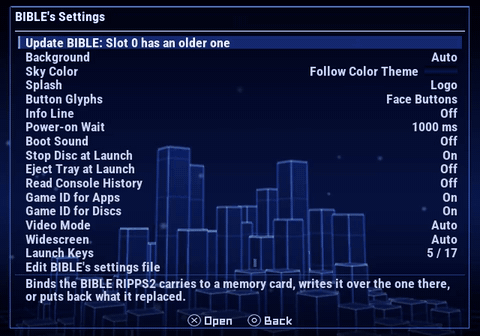
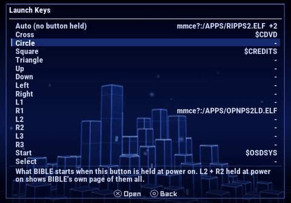
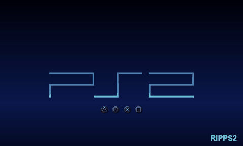
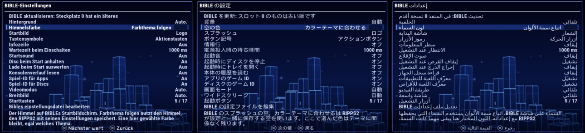

## Rip it: RIPPS2 v1.4.1 beta (build 141)

**[Download RIPPS2.elf](https://github.com/akilluminati47/RIPPS2/releases/download/v1.4.1-beta/RIPPS2.elf)** (one file, 2,775 KB) and put it in place of your old one. Your settings stay where they were. **[RIPPS2-languages.zip](https://github.com/akilluminati47/RIPPS2/releases/download/v1.4.1-beta/RIPPS2-languages.zip)** has RIPPS2 in 33 languages, and the **[theme pack](https://github.com/akilluminati47/RIPPS2-themes/releases/latest)** stays at edition 136.

**This one has only run in the PCSX2 lab**, as has most of [1.4.0](https://github.com/akilluminati47/RIPPS2/releases/tag/v1.4.0-beta), which came out with it. Nothing here has been on a real PS2 yet, so your reports count. The pictures below open silent videos from this repo.

### BIBLE's settings, on a proper page

<a href="https://github.com/akilluminati47/RIPPS2/blob/main/media/b141/bible-page.mp4">Watch: every row and its tip</a>

With BIBLE on a card, **Settings > General > Boot Loader > Manage** opens a page like Settings and Set Metadata (Rename), not a small list.

- **A tip on every row** says what it does and what it costs. Stop Disc at Launch says what it saves, Power-on Wait says what a boot sound adds at 0 ms.
- **The cursor stays where it is.** Left and Right change a value, and confirm is the next value.
- **Nothing waits on the card while you choose.** The file is written once, when you leave the page.
- **A pulled card cannot leave BIBLE half a file.** RIPPS2 writes a temporary copy, reads it back whole, then gives it the real name. If the power goes in between, the next visit puts it right. Your notes and every other line stay as they were.
- **Boot Sound** is on the page too, the same setting as in Audio.

### Launch keys, chosen from your drives

<a href="https://github.com/akilluminati47/RIPPS2/blob/main/media/b141/launch-keys.mp4">Watch: L1 gets a program, a command and a third path</a>

**Launch Keys** on that page lists what each button starts. Open a button for its name and its ten paths. BIBLE tries them in order and starts the first it finds. For each path:

| Choice | What it does |
|---|---|
| **Choose a program** | The real Memory Files browser, with START DRIVES. Pick an ELF and it is written the way BIBLE reads it: `mc?:/`, `mmce?:/`, `usb:/`, `ata:/`, `mx4sio:/` or `hdd0:` |
| **Type a path** | The keyboard, for a KELF or anything else |
| **A BIBLE command** | The console's browser, the disc in the tray, the disc without the PS2 logo, or BIBLE's credits |
| **Arguments** | What BIBLE hands that program, in order |

Square clears a path. Three things it tells you first:
- **BOOT LOCK's lines only show.** Turn BOOT LOCK off to change them.
- **The last path stays.** A settings file with no paths at all sends BIBLE to its rescue mode, so RIPPS2 will not clear the last one.
- **A path your card's BIBLE cannot read says so.** A memory card build does not read `mmce?:`, and no card build reads `ata:` or `hdd0:`. BIBLE moves on to the next path, and the row tells you.

Hold **L2 + R2** at power on to see BIBLE's own page of them all.

### Sky Color

BIBLE itself, booted in the lab once for each colour, reading the file RIPPS2 wrote

**Follow Color Theme** uses the sky RIPPS2 saves with its settings. Pick a Color Theme by name and BIBLE keeps that sky, whatever RIPPS2 is showing. A swatch on the row shows the three colours.

### In your language

All of it is in the language pack, in all 32 translations.

#### What was tested
| What | Where | Result |
|---|---|---|
| Every row, its tip, stepping values | PCSX2 lab | One screen, nothing under the hints, the cursor stays |
| Choosing ELFs on a card and on an exFAT drive, a command, an argument, clearing a path | PCSX2 lab, then the card read back | `mc?:/APPS/...`, `ata:/APPS/...`, `$OSDSYS`, the argument and the cleared line all as chosen |
| BIBLE reading what RIPPS2 wrote | PCSX2 lab, BIBLE's MMCE build | Its splash in each sky above |
| Power cut between the two steps of a save | PCSX2 lab, a card with only the temporary file | The file came back whole. The first try lost it, which is fixed |
| The last path, BOOT LOCK's lines | PCSX2 lab | Refused, with the reason |
| German, Japanese, Arabic | PCSX2 lab | The tips fit |
| BIBLE to RIPPS2 to a game, on the final build | PCSX2 lab | The boot sound handed over in RAM, 0.13 s after the towers; the music started once; the game started |
| **Any of this on a real PS2** | | **Not run yet** |
| `usb:/`, `mmce?:/`, `mx4sio:/` and `hdd0:` paths from the browser | | Not run: no such drive in the lab. They use the same code as BOOT LOCK's, except `hdd0:` |

#### Known
- **Read Console History changes nothing yet.** BIBLE 3282396 reads the key and nothing uses it. Its tip says so.
- BIBLE's hand-off of the boot sound in memory has only passed in the lab. On a real SD2PSX, RIPPS2 reads the card's copy itself.

### Please test
Set a launch key to a program on your own drive, power on holding that button, and tell us if it starts. Then hold L2 + R2 at power on and check BIBLE's page matches. Please [open an issue](https://github.com/akilluminati47/RIPPS2/issues) with your console model, your card and your `DIAG.TXT`.

Full list of changes: [CHANGELOG.md](https://github.com/akilluminati47/RIPPS2/blob/main/CHANGELOG.md).
