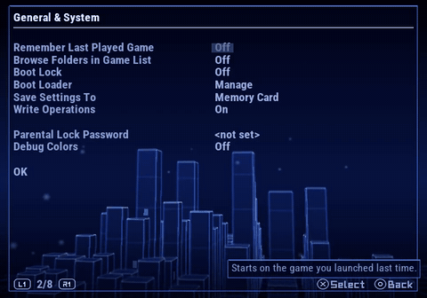
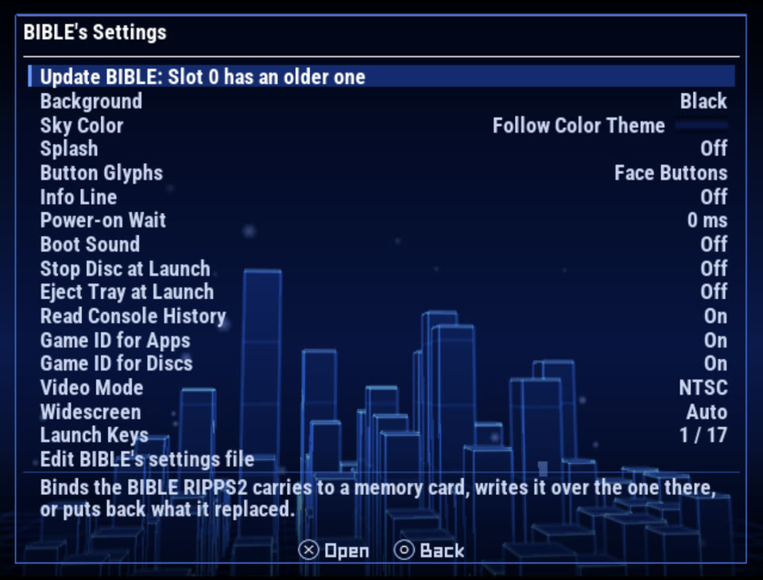
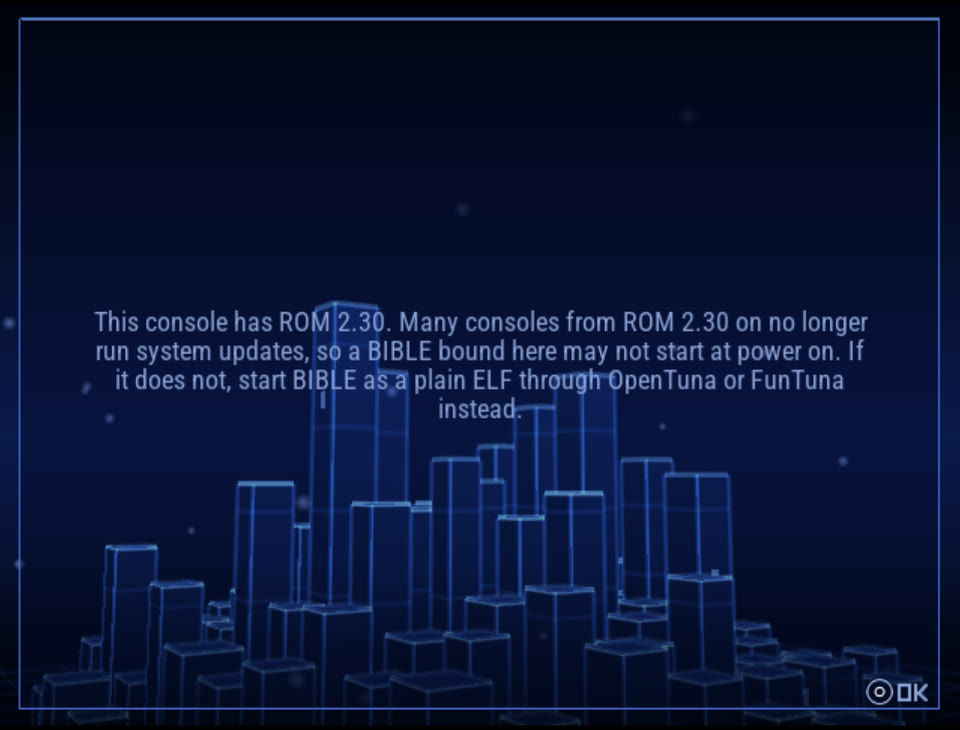
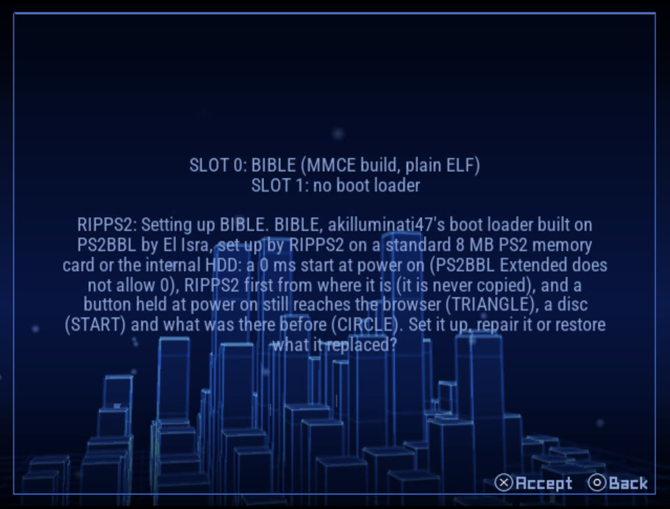

## Rip it: RIPPS2 v1.4.3 beta (builds 142 and 143)

**[Download RIPPS2.elf](https://github.com/akilluminati47/RIPPS2/releases/download/v1.4.3-beta/RIPPS2.elf)** (one file, 2,750 KB) and put it in place of your old one. **[RIPPS2-languages.zip](https://github.com/akilluminati47/RIPPS2/releases/download/v1.4.3-beta/RIPPS2-languages.zip)** has RIPPS2 in 33 languages, and the **[theme pack](https://github.com/akilluminati47/RIPPS2-themes/releases/latest)** stays at edition 136.

**This one has only run in the PCSX2 lab**, not on a real PS2 yet, so your reports count. The picture below opens a silent video from this repo.

### Save Settings To stays

<a href="https://github.com/akilluminati47/RIPPS2/blob/main/media/b143/save-settings.mp4">Watch: choosing a drive that had not started</a>, and <a href="https://github.com/akilluminati47/RIPPS2/blob/main/media/b143/save-settings-next-boot.mp4">the next boot, still on it</a>

Thanks to nuno6573 for reporting this. Two causes, both old:

- **A settings file beside RIPPS2.ELF beat your choice.** With RIPPS2 in `mc?:/RIPPS2`, the save went to your drive, then the next boot read the card and showed Memory Card again. Your drive goes first now. If it has nothing to read, the old file is read as before.
- **The row refused a drive that had not started.** USB and MMCE begin on Manual, so it said **THAT DRIVE IS NOT CONNECTED** with the drive plugged in. It starts that drive now, and only says so if the drive really is not there.
- **MMCE and Fast Boot** go the same way as the boot now: MMCE waits for the card, and Fast Boot names a drive by its type.

**If you hit this before:** your old choice is still on the card, and RIPPS2 follows it now. It reads that drive's older settings and the row shows that drive. To stay on the card, choose Memory Card and Save Changes.

### BIBLE f5705eb inside

Signed by akilluminati47. **If your card has BIBLE, Manage offers the update**, and you need it for the first fix:

- **The AUTO hang is fixed.** A missing file on an AUTO path, on a drive BIBLE has to load a driver for (USB, MMCE, MX4SIO, HDD), stopped the boot on the splash for good. BIBLE moves on to the next path now. Until a card takes the update, that card keeps the hang.
- **BIBLE no longer reads the boot sound into memory.** It only tells RIPPS2 the folder. The read never reached RIPPS2 on an SD2PSX, and on a memory card launch it only moved the wait into BIBLE. In the lab, with the config Manage writes, the towers came about 0.8 s sooner, and the sound still comes 0.14 s after them. RIPPS2 still takes the copy from a card on an older BIBLE.
- **BIBLE's own icon** on its folders.
- About 9.6 KB off each of BIBLE's MMCE, MX4SIO and HDD builds, and RIPPS2.elf is 25 KB smaller.

Details and the lab's numbers are on [BIBLE's release page](https://github.com/akilluminati47/BIBLE/releases/tag/signed-f5705eb).

### ROM 2.30 and newer

Many consoles from ROM 2.30 on no longer run system updates, so a bound BIBLE may not start at power on. Manage says so on those ROMs and still lets you try, since not all of them lost it. BIBLE also comes as a plain ELF on [its release page](https://github.com/akilluminati47/BIBLE/releases/tag/signed-f5705eb), for OpenTuna or FunTuna to start from `mc?:/BOOT/BOOT.ELF`.

Manage recognises that plain BIBLE, so its settings rows work and the list says what it is. RIPPS2 does not carry or install it.

#### What was tested
| What | Where | Result |
|---|---|---|
| RIPPS2 in `mc0:/RIPPS2`, save to the drive, power cycle | PCSX2 lab, internal HDD (the same way as USB) | Stays on the drive. 1.4.1 went back to Memory Card |
| Back to Memory Card | PCSX2 lab | Stays on the card |
| Manual mode, the drive never started, no RIPPS2 folder on it | PCSX2 lab | Starts it, saves, stays. 1.4.1 said it was not found |
| The drive gone at the next boot | PCSX2 lab | Waits (10 s for an HDD), reads the old file, no hang. Drive back: its settings return |
| Fast Boot with the drive as home; HDD autolaunch | PCSX2 lab | Both read the drive |
| USB and MMCE rows with no such device | PCSX2 lab | "NOT CONNECTED" after the wait, no hang |
| AUTO with `mmce?:/APPS/RIPPS2.ELF` and no device | PCSX2 lab, BIBLE's MMCE build | Moves on to the next path in about 2 s |
| Manage: a plain BIBLE, the same file altered, 3282396, f5705eb | PCSX2 lab | Each named as it should be; the altered one not taken for BIBLE |
| The ROM 2.30 warning | PCSX2 lab, a test build told it has ROM 2.30 | The warning, then the usual screen. None on the lab's own ROM |
| BIBLE to RIPPS2 with a real set: art pack, music, sounds, a game | PCSX2 lab, the final build | Boot sound 0.14 s after the towers, music started once, the game started |
| **Any of this on a real PS2, a bind of this BIBLE and its icon on a card** | | **Not run yet** |
| A real USB drive or MMCE as the settings home; USB autolaunch | | Not run: not in the lab |

#### Known
- **An APA HDD not yet mounted** still says NO INTERNAL HDD FOUND. Only an exFAT drive is started from the row. Start the HDD's source first.
- **Read Console History changes nothing yet.** BIBLE reads the key and nothing uses it. Its tip says so.

### Please test
Choose your USB drive or MMCE in **Settings > General & System > Save Settings To**, Save Changes, power cycle, and check the row. Then take **Update BIBLE** if your card offers it, and tell us if it starts at power on. Please [open an issue](https://github.com/akilluminati47/RIPPS2/issues) with your console model, your card and your `DIAG.TXT`.

Full list of changes: [CHANGELOG.md](https://github.com/akilluminati47/RIPPS2/blob/main/CHANGELOG.md).
